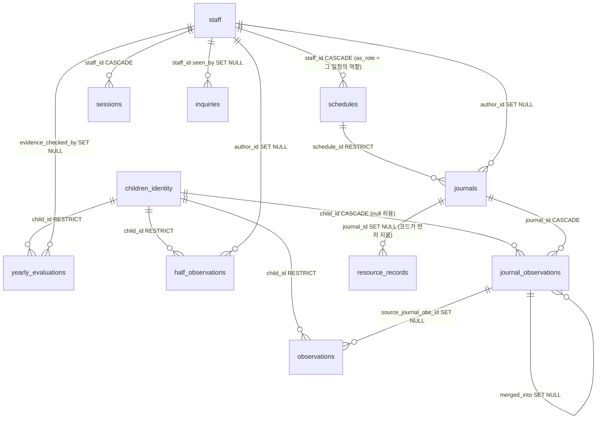
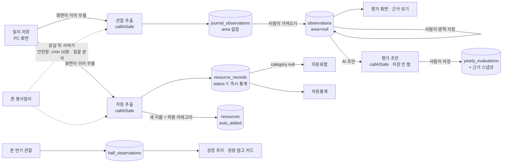

# OK 시스템 기능 지도

> 점검 준비용 문서. **코드 기준**(기억·기존 문서 아님) — 라우트(`api/mod.ts`)·핸들러(`api/*.ts`)·
> DB 함수(`db/*.ts`)·마이그레이션(`db/sql/001~034`)·화면 JS(`web/assets/**`)에서 실제로 있는 것만 적었다.
>
> - 기준: `main` `261211f` (2026-09-16) 에서 작성, **1차·2차 수정 묶음 반영(2026-09-16)**.
>   고친 후보는 7장에서 ✅ 로 표시했다.
> - 라우트 목록은 실제 라우터에 가짜 메서드로 물어 뽑은 109개(경로×메서드)와 대조했다
>   (`api/route_coverage.ts` 방식). 정책표 기본값(관리자만)으로 떨어지는 경로 0, 유령 줄 0.
> - 처음 쓸 때는 코드를 고치지 않았다. 이상한 것은 맨 끝 [7. 점검 후보](#7-점검-후보)에 모았다.
> - **반기별 관찰(봉사자 반기 점수) — 숨김(2026-09-17), 데이터 보존, 복원 가능.** 아래에서 **〔숨김 2026-09-17 — 데이터 보존, 복원 가능〕** 가 붙은 줄은 지금 화면·주소가 닫혀 있다.
>   닫은 것: 폰 일지 탭 배너·반기 관찰 화면 입구, PC 성장 추이 카드·평가 정량 참고 카드·[봉사자 설정] 열림·닫힘/항목 카드,
>   `/api/my/children`·`/api/my/observations/:id`·`/api/children/:id/growth`·설정 `half_observation_open`/`half_observation_items`(읽기·쓰기) → **404**, 평가 조회 `quant` 는 늘 null.
>   그대로: half_observations 테이블·데이터·마이그레이션(023~025)·정책표 줄·**아동 삭제 연쇄(027)**·감사 로그·핸들러 코드.
>   되살리기: `lib/features.ts` `HALF_OBSERVATION_ENABLED`·`web/assets/features.js` `HALF_OBSERVATION` 을 true, 폰은 `web/m.html` 배너 hidden·`m/app.js` SCREENS·`m/journal.js` 입구 주석을 푼다.
> - **③단계(2026-09-17) — 인쇄 3종·동의 체계·넓은 화면.** 동의서·개인정보 처리방침·센터 이름은 **편집형 문구**다:
>   settings(`consent_form`·`privacy_policy`·`center_name`)에 저장되고 [설정 › 동의서 › 문구 수정]에서 고친다(센터장 이상, 변경 기록).
>   코드(`lib/documents.ts`)에는 **처음 한 번 쓰는 기본값**만 있다 — AI 업체(Anthropic)·보관 서버(Supabase) 이름이 바뀌면 코드가 아니라 이 글을 고친다.
> - 표기: **P** = PC 전용(모바일 계정은 403), **M** = 모바일 계정도 허용.
>   🔴 아동 신원 · 🟡 아동 기록(child_id) · 🟢 사람 무관 · ⚙ 시스템

---

## 목차

1. [화면 지도](#1-화면-지도)
2. [API 지도](#2-api-지도)
3. [권한 매트릭스](#3-권한-매트릭스)
4. [데이터 흐름 지도](#4-데이터-흐름-지도)
5. [외부 의존](#5-외부-의존)
6. [요청이 지나가는 길](#6-요청이-지나가는-길)
7. [점검 후보](#7-점검-후보)

---

## 1. 화면 지도

### 1.0 들어가는 문

| 주소 | 누가 | 동작 (`main.ts:75-91`) |
|---|---|---|
| `/login` | 누구나 | 이미 세션이 있으면 모바일 계정 → `/m`, 그 외 → `/`. **동의 전(034 뒤) 계정은 머문다** — 동의 화면 |
| `/privacy` | 누구나(로그인 없이) | 개인정보 처리방침(`privacy.html`, `GET /api/public/privacy`). 로그인 화면 하단 링크로 **같은 창**에서 열고 [← 뒤로] = 온 화면(주소로 바로 왔으면 `/login`) |
| `/print` | PC(종사자 이상 API) | 인쇄 화면(`print.html`) — 세션 없으면 `/login`, 모바일 계정은 `/m` |
| `/` | PC | 세션 없으면 **잠금일 때** `/login`(AUTH_ENFORCE=true, 또는 비었거나 false 이고 최초 부팅이 끝남 — warn 이면 안 보냄). 모바일 계정이면 `/m` |
| `/m` | 봉사자 폰 | 세션 없으면(잠금 시) `/login`. PC 계정이 와도 막지 않음 |

`/`·`/m`·`/print` 는 세션이 있어도 **개인정보 처리 동의 전**(034 적용 뒤 `staff.privacy_agreed_at` 이 빈 계정)이면 `/login` 으로 보낸다. 034 전 DB 에서는 묻지 않는다. 동의 확인이 실패하면 막지 않는다.

### 1.1 로그인 · 최초 부팅 (`web/login.html`, `login.js`, `api/auth.ts`)

시작 시 `GET /api/auth/state` → `bootstrap` 값으로 두 화면 중 하나.

| 화면 | 볼 수 있는 것 | 조작 → API | 이동 |
|---|---|---|---|
| 로그인 | 이름·비밀번호 칸 | [로그인] → `POST /api/auth/login` | 모바일 계정 → `/m`, PC → `/` |
| 초대코드 1단계 | 이름·숫자 6자리 | [코드로 시작] → `POST /api/auth/verify-code` (확인만) | 2단계 |
| 초대코드 2단계 | 비밀번호·확인 + **개인정보 처리 안내·동의 체크(필수)** | [정하고 시작] → `POST /api/auth/first-password` (이름+코드+비번+`agreed` 를 **다시 함께** 보냄 — 서버에 단계 상태를 남기지 않음, 동의 안 하면 코드 확인 전에 400) | 들어감(동의 시각 기록) |
| 개인정보 처리 동의 | 안내문(설정의 처리방침 `staff_notice`)·전문 링크·체크 | [동의하고 시작] → `POST /api/auth/consent` / [로그아웃] | 로그인 응답 `consent_needed` 또는 `GET /api/auth/consent` 가 needed 일 때 |
| 최초 관리자 등록 | 후보(센터장·생활복지사) 선택, 비밀번호 | [등록] → `POST /api/auth/bootstrap` | `/` |

- 잠금: 5회 실패 → 15분. 잘못된 초대코드도 같은 횟수로 셈. 코드 유효 30일·1회용.
- 차단 순서: 명단 종료 → 정지 → 비번 미설정 → 잠김 (`lib/permission.ts:93`).
- 세션: 쿠키 `ok_session`(HttpOnly, SameSite=Lax, https면 Secure), DB에는 SHA-256만.
  유휴 8시간 · 절대 30일. 정지·명단 종료 계정은 세션이 있어도 무효.
- 뒤로 가기(bfcache)로 돌아오면 입력값을 버리고 처음부터.
- 하단 [개인정보 처리방침] 링크 → `/privacy`. 안내 문구는 `GET /api/public/privacy` 에서(못 받으면 기본 한 줄).

### 1.2 PC 공통 틀 (`index.html`, `app.js`, `me.js`, `ui.js`)

- **앱바**: 이름 · 등급 태그 · [로그아웃](`POST /api/auth/logout` → `/login`). 모바일 계정이면 `/m`으로 보냄.
- **메인 메뉴** 아동 / 자원 / 설정 (`.rail`, `data-rail`) — 화면 폭에 따라 두 모양:
  - **넓은 화면(720px 초과)**: 왼쪽 아이콘 레일(88px, 설정은 아래쪽) + 그 옆 **서브탭** 세로 칸(200px).
    본문(`.main__inner`)은 **최대 880px, 가운데**(③단계 후속 — 폭은 규정대로 좁게, 위치만 가운데). 1280·1920 에서 본문 폭 880px 로 같고 좌우 여백만 달라진다(1280 왼쪽 337px, 1920 657px).
    태블릿(768·834, 마우스 기준)은 레일+서브탭 288px 을 빼면 본문이 430~480px — 달력 이름이 11px, 도서 표는 옆으로 굴러감(분기점은 그대로, 상의 대상).
  - **좁은 화면(720px 이하)**: 화면 아래 **탭바**(/m 과 같은 모양 — 아이콘+라벨, 칸 높이 56px, 고른 탭은 초록 윗줄).
    탭바는 격자의 마지막 줄이라 본문(.main)만 굴러가고 끝이 가리지 않음. **서브탭**은 앱바 아래 가로 칩 띠.
    [↑ 맨 위로]·스낵바는 탭바 위로 비켜 섬, 모달은 탭바를 덮음. iOS 안전 영역: `viewport-fit=cover` + 앱바 위·탭바 아래 `env(safe-area-inset-*)`.
  - **좁은 화면 대개편(종사자 모바일)** — 전부 `@media (max-width: 720px)` 안(넓은 화면 무변화, 18화면 배치 비교로 확인):
    - 아동 축: 첫 줄 그룹 탭 셋 [아동][종사자][멘토+봉사자](세 칸 각 1/3 고정폭·글자 가운데, 고른 표시는 배경색만 — 굵기 같음), 고른 그룹의 화면 칩은 둘째 줄.
      첫 줄 높이는 둘째 줄 유무와 상관없이 같다(탭 아래 여백 8px 를 탭 쪽에 둠 — [아동]만 골랐을 때 첫 줄이 달라 보이던 것 고침, 10차).
    - 설정 축은 **평평한 칩 한 줄**(③단계 후속): [문의함][계정 관리][시스템 점검] — 등급이 되는 것만. 봉사자 설정·관찰 영역·변경 기록·관문 경고·동의서는 **PC 전용**(`index.html` `data-pc-only`, 좁은 화면에서 숨김). 그룹 칩 없음. 설정을 보던 중 좁아지면 열 수 있는 항목으로 옮김(`app.js pcOnlyHere`).
      고를 때 화면을 옆으로 밀지 않는다 — 둘째 줄 안에서만 민다(`app.js` `slideInto`; 예전 `scrollIntoView` 는 iOS 에서 화면 전체를 끌었다). 상세의 [← 목록으로] 는 왼쪽 위.
    - 명단 3종(아동·종사자·봉사자): 표 대신 줄 — "이름 역할알약 상태알약 전화"(아동은 "이름 학년 성별 상태"). 겸직은 역할마다 알약 하나([멘토][봉사자], "겸직" 글자 태그는 넓은 화면만) — 360px 에서도 한 줄. 전화는 `tel:` 링크(누르면 전화),
      한 줄에 안 들어가면 전화만 둘째 줄 오른쪽(staff.js `markWrappedPhones` 가 `is-wrapped` 표시, 숫자 꺾임 없음). [수정]/[삭제]·[+ 등록] 숨김,
      "등록·수정은 PC에서 할 수 있어요" 한 줄(`.narrow-note`). `.wide-only` / `.narrow-only` 로 가른다.
    - 화면 제목 글자 없음(/m 처럼 컨트롤부터) — 위치는 위 칩이 말한다. 건수("N건"·"N명")도 없음(시스템 점검의 실행 결과 한 줄만 남김).
    - **달 이동(일지 4종·스케줄)**: ‹ [2026년 9월 ▾] › — 달 이름을 누르면 /m 과 같은 **달·날짜 고르기 판**(`m/month_picker.js` 한 벌을 PC 도 import, 모양은 style.css `.mpick`).
      판에서 달 넘기기·[N월 전체]·날짜(첫 탭 시작일, 둘째 탭 종료일, 같은 날 두 번 = 하루). 고르면 버튼이 "9월 2일" / "9월 2일~9월 5일" + [×](달 전체로).
      바깥·Esc 로 닫으면 원래 그대로, ‹ › 는 기간을 풀고 달 이동. 일지는 그 기간을 서버에서 받고(`from/to`, 봉사일지 외 종류도), 스케줄은 하루면 그날 목록,
      기간이면 달 목록을 그 기간으로 거르고 달력 칸을 칠함(일정은 달 단위로 받으므로 기간은 시작일의 달 안으로 자름 — 넘치면 스낵바).
    - 일지 목록: [일괄 분석 N]·"모두 분석됨" 알약과 [+ 일지 작성] 한 줄(`.jtools`), 달 이동 줄 가운데,
      검색창은 좁은 화면에 없음(넓은 화면에서 건 검색이 남아 있으면 달 이동 아래 한 줄로 무엇을 보는지만 적음). 카드 머리는 날짜 크게·작성자·역할 알약·시간.
    - 스케줄: /m 일정 탭 순서 — 요약 카드 → ‹ 달 ▾ › 크게(옆에 "일정 N건") → 역할 칩·[+ 등록] → 달력(점 ●■) → 목록. [+ 일정 등록] 시트는 줄만 더하고 시트 끝으로 내려 [+ 날짜 추가]·[등록] 이 같은 자리(/m 과 같은 방식).
      날짜를 안 고르면 "9월 전체" 목록, 고르면 그날 목록([닫기]로 달 목록). 줄은 한 줄 "날짜 · 이름 · 시간 · 역할알약 · ✎ · ×"(아이콘 44px).
    - 작성: **종사자 일지(프로그램·일상·회의록)도 봉사일지처럼 모달** — `journals.js` 가 작성 화면(section)을 모달 안으로 옮겼다가 닫으면 제자리로(목록은 뒤에 그대로).
      바깥·Esc 는 쓰던 글이 있으면 "쓰던 내용을 버릴까요?", [취소] 는 바로 닫음. 새 작성은 **작성자 칸 없음 = 본인**(author_id 를 안 보냄), 수정은 작성자 칸 있음.
      칸은 세로 한 줄·모두 같은 폭(100%, iOS 날짜 칸은 `appearance:none`). 들어올 때 본문 초점 없음. [저장]·[취소] 는 모달 카드 아래에 붙음.
      개인정보 안내는 첫 줄 + [자세히 ▾](넓은 화면은 늘 펼침·버튼 없음).
    - 아동 상세: 아동 정보는 접힌 한 줄 "▸ 아동 정보 초3 · 재원", 펼치면 상세 + [수정][삭제](펼친 안 맨 아래). "한눈에" 상자 없음.
      영역별 관찰은 **읽기 전용** — [날짜별·편집 →]·[편집 화면에서 영역 지정하기 →] 숨김, "관찰 편집은 PC에서" 한 줄, 영역 타일은 펼쳐 읽기.
      연간 평가는 "▸ 연간 평가" 로 접힘 — 펼치면 보기·수정·저장·AI 초안·근거 확인 전부 그대로.
- **등급별 서브탭 숨김**(`me.js:24`): 변경 기록·관문 경고·시스템 점검·**관찰 영역** = 관리자, 계정 관리 = 센터장 이상.
  나머지는 숨기지 않음(서버가 거절하면 스낵바). [설정] 첫 화면은 등급이 열 수 있는 첫 서브탭(센터장 → 계정 관리, 종사자 → 문의함).
- **공통**: [↑ 맨 위로], 확인창(바깥 클릭·Esc = 취소), 위험 삭제의 갈림길·이름 입력 관문(`danger_dialog.js`),
  설명 태그(ⓘ, 누르면 스낵바 — `ui.explain`), 터치 화면 안내(`.touch-only`).

### 1.3 PC 화면 18개 (+ 딸린 화면)

#### 아동 › 아동

**명단** (`#view-list`, `children.js`)
- 볼 것: 이름·학년·성별·상태 배지(재원/종결/종결 예정/입소 예정), 인원 수.
- 순서(4차): **학년 오름차순(초1→초6→중1…) → 같은 학년 안 가나다**, 생년월일 모름은 맨 뒤. 서버가 정렬(`lib/child_order.ts` — 학년 = 출생 연도라 출생 연도 내림차순, 글자 정렬 아님), 등록·수정 뒤 화면도 같은 규칙(`grade.js compareChildren`). 폰 반기 명단·일지의 아동 고르기도 같은 순서.
- 조작: [재원]/[종결] 칩 · 이름 검색(화면 안) · [+ 아동 등록] · 이름 → 상세. 데이터 `GET /api/children`.

**등록·수정** (`#view-child-form`)
- 칸: 이름, 생년월일(학년 힌트), 성별, 학교, 입소일, 상태, 종결일(종결일 때), 보호자 관계·연락처, **개인정보 동의서 받은 날(선택, 034 — 기록만, 제외 로직 없음, 오늘 뒤 불가, 034 전 DB 면 값 넣을 때 "034 필요")**, 주소, 의뢰배경.
- [저장] → `POST /api/children` / `PATCH /api/children/:id`. [취소]·[← 돌아가기] → 온 곳.

**상세** (`#view-detail`)
- 머리: [← 명단으로], 이름·학년·성별·상태, 연도 **‹ 2026년 ›**(올해에서 시작, 입소한 해 ~ 올해 — 입소일 모르면 10년 전부터), [상반기]/[하반기].
  "한눈에" 요약 상자는 없다(넓은·좁은 화면 모두).
- **아동 정보 카드**: 접힘(학교·입소일·상태) / ▸ 펼침(생년월일·보호자·주소·의뢰배경, `GET /api/children/:id`).
  펼침에 "동의서 받은 날"(없으면 -). [수정] → 수정 화면. [삭제] → `GET …/records-count`(관찰·평가·**반기 관찰**(숨긴 기능 — 있을 때만 알림)·일지관찰) → 갈림길([종결로 변경]/[삭제 진행]) → 기록 있으면 이름 입력 → `DELETE /api/children/:id`(DB 함수 하나로 한꺼번에).
- **영역별 관찰**(읽기): 영역 타일(지금 쓰는 영역 + 관찰이 남은 **예전 영역**(회색·점선) + 미지정), 누르면 펼침 — **15건씩 + [더 보기 (N건 남음)]**,
  **타일을 다시 누르면 접힘**(토글), [전체 펼치기]↔[전체 접기](관찰이 있는 칸이 다 펼쳐졌을 때 "전체 접기" — 새 영역·예전 영역 칸도 셈에 넣음), "근거 일지 수정됨/삭제됨" 태그(ⓘ). **🖨**(툴팁 "인쇄", 새 창 관찰일지 — 넓은 화면만) · [날짜별 · 편집 →]. 데이터 `GET /api/observations?child_id&year&half`(반기 전체 한 번).
  영역 이름 바꾸기 등은 **[설정 › 관찰 영역]** 하나(관리자 전용 — 화면 `SETTING_NEEDS`·서버 정책표 PUT 둘 다 관리자, PC 전용). 아동 상세의 [영역 관리] 모달은 뺐다(③단계 후속). [취소] = 고치던 것 버리기.
  이름 바꾸기·[+ 추가]·[삭제]/[되살리기] → `PUT /api/settings/observation_areas`. 칸 옆에 코드·옛 이름은 보이지 않는다(코드는 내부용). 안내는 한 줄.
  코드 불변(처음 여섯은 이름 = 코드, 새 영역 a01…), 지운 영역은 목록에 deleted 로 남아 그 관찰은 미지정으로 안 떨어지고 "예전 영역".
  지운 영역은 새로 고를 수 없음(서버 400). DB 031(영역 CHECK 제약 풀기) **운영 적용됨(2026-09-17)** — 새 영역(a01…) 추가 → 관찰 지정 → 저장까지 확인. 031 없는 DB 라면 "031 필요" 안내.
- **〔숨김 2026-09-17 — 데이터 보존, 복원 가능〕** **성장 추이**(`growth.js`, `GET …/growth`): 반기·관찰자별 영역 평균 표(평균으로 뭉개지 않음),
  `
` 항목별 점수(삭제된 항목은 지난 점수 있을 때만), 특이사항. 조작 없음.
- **연간 평가**(`evaluation.js`, 실제 단위는 반기) — **"▸ 연간 평가" 로 접혀 있음**(넓은·좁은 화면), 펼치면 아래 전부.
  칸 = 지금 쓰는 영역 + 글이 남은 예전 영역. 편집 칸은 보기 글과 같은 글자 크기·같은 폭·같은 자리(넓은 화면). **폭은 카드 안쪽 전체**(10차 — 예전 읽기 폭 736px 제한을 뺌, 1280 화면에서 879px, 보기=편집).
  AI 초안은 지금 쓰는 영역만(키 = 코드, 이름이 다르면 "a01(자립)" 로 알려 줌).
  - **〔숨김 2026-09-17 — 데이터 보존, 복원 가능〕** 반기 정량 참고 카드(영역 평균, 관찰자 수 — AI 초안에는 안 들어감).
  - 보기 모드에 **🖨**(툴팁 "인쇄", 새 창 평가서 — 넓은 화면만).
  - 근거 스냅샷 배너: 저장 후 근거가 바뀌면 건수·[자세히]·[확인함] → `POST …/evaluation/evidence-check`.
  - 보기: [수정], 영역별 [근거 보기]. 편집: [AI 초안 생성](`POST …/evaluation/draft`, 저장 안 함) · [저장](`PUT …/evaluation`) · [취소].
- **날짜별 편집** (`#detail-edit`, `obs_edit.js` 공용)
  - [← 관찰 보기로], [일지에서 가져오기], [+ 관찰 직접 추가](→ `POST /api/observations`).
  - **10건씩 그린다** — 목록 끝이 보이면 이어서(IntersectionObserver + 본문 스크롤 안전망), [더 보기 (N건 남음)]. **[미지정만 보기 N]** 켜고 끄기, "전체 N건".
  - 줄마다: 영역 선택(`PATCH …/:id/area`), [수정](`PATCH …/content`), [나누기](`POST …/split`), [삭제](`DELETE`).
    영역 저장은 **줄마다 따로**(같은 줄을 연달아 바꾸면 마지막 것만 반영), 목록을 다시 그리지 않고 영역 칸 건수·평가만 새로 셈.
    (예전: 저장 하나가 끝나기 전 다른 줄 선택을 통째로 무시 → 앞 저장이 끝나 목록을 다시 그릴 때 그 줄이 "미지정" 으로 돌아감. 위에서부터 빠르게 고를 때 재현)
    예전 영역인 관찰은 고르는 칸에 "(예전 영역)" 으로 보이기만(고를 수 없음).
  - **합치기 = 끌어 놓기만**(같은 날짜·같은 원본 일지) → `POST …/:id/merge`. 터치 화면은 "PC에서" 안내.
- **일지에서 가져오기 모달**: 후보 체크(가져옴/합쳐짐은 잠금), [전체 선택/해제], [선택한 관찰 가져오기] → `POST /api/observations/import`. 데이터 `GET …/importable`.

#### 아동 › 종사자 › 종사자 명단 · 멘토+봉사자 › 봉사자 명단 (`staff.js`, 한 벌)

- 볼 것: 이름·역할·상태·전화·동작. 칩 [전체](=활동중만)/[퇴사|종료], 검색.
- **종사자 등급은 보기만** — [+ 등록]·[수정]·[삭제](종료 포함) 버튼이 안 보인다(서버가 센터장 이상만 받음, `me.js viewerAtLeast`).
  센터장이 **관리자 계정과 같은 이름**을 등록하면 [역할 추가]·[종료자 이름 바꾸기] 대신 "관리자만 할 수 있어요" 안내만(409 응답의 `holder_is_admin`).
- 역할 칸은 **그 명단의 역할만** 체크박스(종사자 명단 [센터장][생활복지사], 봉사자 명단 [멘토][봉사자]). 다른 명단의 역할(겸직)은 잠긴 알약 "멘토 — 봉사자 명단에서 관리" 로 보이기만 하고 저장 때 그대로 실린다.
  수정에서 이 명단 역할을 다 빼면 "○○ 명단에서 빠질까요?" 확인 뒤 저장, 이 명단에서 내림. 서버 역할 검증은 그대로(어떤 조합이든 저장).
  **등록 때** 같은 이름이 다른 명단에만 활동중으로 있으면 "이미 종사자로 있는 ○○ 님에게 멘토 역할을 더할까요?" → [역할 추가](`PATCH /api/staff/:id {roles}`, 등록 안 함) / [다른 사람이에요](예전 흐름 — 서버가 같은 이름 안내). 같은 명단에 이미 있으면 묻지 않고 예전 흐름.
- 조작: [+ 등록] 모달(`POST /api/staff`), [수정] 모달(상태 포함, `PATCH /api/staff/:id` — 종료 → 활동중이면 옛 비밀번호가 비워지고 "초대코드를 새로 발급" 안내),
  [삭제] → `GET …/records-count` → **일지가 있으면** "삭제할 수 없어요" + [종료로 변경]만 /
  없으면 갈림길([종료로 변경]/[삭제 진행]) → (건수를 모를 때만) 이름 입력 → `DELETE /api/staff/:id`.
- 숨김: 관리자 행은 비관리자에게 "관리자만 변경". 종사자에게도 버튼은 보임(서버는 센터장 이상).

#### 아동 › 종사자 › 프로그램 · 일상 · 회의록 / 멘토+봉사자 › 봉사일지 (`journals.js`, kind 공용)

- **목록 머리줄(넓은 화면)**: ‹ [2026년 9월 ▾] [📅] › (브라우저 기본 달 칸은 숨김 — 달 글자와 📅 모두 같은 달·날짜 판) · [9월 2일~9월 5일 ×](기간을 걸었을 때) · **통합 검색창** · [미분석 일괄 분석 N] [+ 일지 작성](둘은 오른쪽 끝에 나란히).
  건수(한 달·기간 전체), [미분석 일괄 분석 N](보는 범위 전체 기준 · 확인창 → 2건씩 추출).
  **15건씩** 받고 아래 [더 보기 (N건 남음)](서버 커서). 건수·미분석은 첫 쪽에 함께 오는 한 달 요약이 기준.
  봉사일지만: 미작성 알림(`GET /api/journals/missing`) → [일지 작성].
- **날짜·기간**(일지 4종): [📅] → 좁은 화면과 같은 **달·날짜 고르기 판**(`m/month_picker.js`, 달 이동 줄 아래에 뜸) — 하루/기간(숙박식)·[N월 전체].
  기간이면 제목 옆 건수가 "2026. 9. 3 ~ 9. 9 · N건", [×] 로 달 전체. ‹ › 는 기간을 풀고 달 이동. 기간 동안 미작성 알림은 안 뜸(달 단위).
- **통합 검색**(일지 4종, 예전 봉사일지 필터 줄 — 역할 칩·이름·기간 — 을 대신함): 작성자 이름·본문·제목에 글자가 있는 일지(**서버** `q` — 본문·제목 LIKE + 이름이 맞은 사람,
  %·_·쉼표·따옴표 글자 그대로). 봉사일지에서는 검색어의 "봉사자"·"멘토" 낱말을 **역할 거르기**(`role`)로 바꿔 보냄("멘토 김" = 멘토 + "김").
  거른 결과를 15건씩(커서), 건수·[미분석 일괄 분석]도 거른 기준. 카드의 작성자 이름·제목·본문에서 맞은 곳을 **표시**(옅은 초록 바탕 + 밑줄, `<mark class="jmark">`).
  미작성 알림도 같은 역할·이름으로 좁힘. 값은 화면 안에만, 다른 일지 종류로 가면 풀림. 조건 밖에 새 일지를 쓰면 "저장했습니다 — 조건 밖" 안내만.
- **카드**: 날짜·작성자(색점)·역할·시각, [수정], [삭제](가져간 관찰·자원 건수 안내 → `DELETE /api/journals/:id`).
  봉사일지만: 수퍼비전 댓글 [달기/저장/삭제] → `PATCH /api/journals/:id {comment}`.
- **[관찰 N] 펼침**(`GET …/observations`): 후보 줄 — 아동 태그/"아동 확인 필요", 가져옴·직접 고침·합쳐짐(ⓘ).
  [수정](`PATCH /api/journal-observations/:id`) · [나누기](`POST …/split`) · [삭제] · 아동 지정(후보 버튼/명단 선택) ·
  끌어서 합치기(`POST …/merge`, 터치는 안내) · [분석하기/다시 분석](`POST /api/journals/:id/extract`, AI) ·
  재분석 비교([기존 유지]/[새 것으로] → `POST …/resolve`).
- **[자원 N] 펼침**(`GET …/resources`): [수정]/[자원 아님]/[삭제]/[되돌리기] → `/api/resource-records/:id`,
  [분석하기](`POST …/extract-resources`, AI), 재분석 비교 → `POST …/resolve-resources`.
- **종사자 일지 작성·수정**(`#view-journal-form`): 날짜·작성자·제목·내용. 넓은 화면은 작성자를 고른다(대리 작성, 처음 값 = 본인). 좁은 화면 새 작성은 작성자 칸 없음(본인). 작성 [저장] → `POST /api/journals` 후 **화면이** 관찰→자원 추출을 이어 부름. 수정은 재분석 안 함.
  (스케줄의 [일지 작성]으로 쓴 봉사일지도 저장 뒤 `analyzeSaved` 로 관찰→자원 분석)
- **봉사일지 모달**(`volunteer_journal.js`): 날짜 → `GET /api/staff/scheduled` → 그날 일정 있는 사람만 작성자 후보(없으면 저장 꺼짐). 수정은 내용만.

#### 아동 › 멘토+봉사자 › 스케줄 (`schedule.js`)

- 볼 것: ‹ [2026년 9월 ▾] [📅] ›(넓은 화면도 달·날짜 판 — 하루면 그날 목록, 기간이면 기간 목록, [×] 로 달 전체), 요약(총 근무/일정/일지 작성/**미작성**) + 역할이 섞인 달이면 "멘토 12시간·5건 · 봉사자 …",
  [사람별 보기 ▾](역할별 **소계** 줄: 명·시간·일정·작성·미작성 → 사람×역할 줄), 달력(칸당 이름 3 + N).
  역할 [전체/봉사자만/멘토만] 은 넓은 화면에서 **달력 상자 안 위쪽**(작게, 범례 옆) — 좁은 화면은 달 이동 아래 줄 그대로(버튼 줄 한 벌을 폭에 따라 옮김).
  **점 모양 = 역할**(봉사자 ●, 멘토 ■ — 색은 사람 색 그대로, 달력 위 범례). 역할을 고르면 달력·요약·사람별·미작성·건수가 모두 그 역할만.
  데이터 `GET /api/schedules?year&month` 하나(앞뒤 달 미리 받아 둠). 역할 거르기는 **화면에서**(서버는 늘 전체 — 캐시가 역할마다 갈리지 않게).
- 조작: 미작성 → 목록 → [일지 작성](봉사일지 모달 → 저장 뒤 자동 분석) · 날짜 칸 → 그날 목록 [수정]/[삭제]/[닫기] ·
  [+ 일정 등록] 모달(사람, 날짜 줄 여러 개, [+ 날짜 추가] — 줄만 더하고 버튼은 화면에 남음, 좁은 화면은 날짜/시각 두 줄) → `POST /api/schedules` ·
  [수정](한 줄, 사람 못 바꿈) → `PATCH /api/schedules/:id` · [삭제] → `DELETE`.

#### 자원 › 자원사전 (`resources.js`)

- 볼 것: 카테고리별 접는 묶음, "자동 등록" 태그(ⓘ), 별칭 조각(옆에 **떼어내기 아이콘** ↗). 데이터 `GET /api/resources`.
- **좁은 화면**: 줄마다 한 줄 — 자원명 · 별칭(글자, 넘치면 …) · 아이콘 버튼 셋 [✎ 수정][× 삭제][⊘ 자원 아님](각 44px, 이름은 aria-label).
  카테고리는 묶음 머리가 곧 카테고리라 줄에는 따로 안 적음. "자동 등록" 태그는 숨김. 별칭 떼어내기·자원 합치기는 숨기고 "별칭 분리·자원 합치기는 PC에서 할 수 있어요." 한 줄
  (넓은 터치 화면=태블릿은 예전 안내 그대로).
- 조작: [카테고리 관리] → 카테고리 화면 · 검색 · **[+ 자원 등록] 하나** · [수정] · [삭제](`DELETE`) · [자원 아님](`GET …/record-count` → `POST …/reject`) ·
  별칭 떼어내기(아이콘 또는 빈 자리로 끌기) → `POST …/split` · **자원 합치기 = 끌어 놓기만** → `POST …/merge`(터치는 안내).
  ([자동 등록만] 칩은 7차에서 뺐다 — 태그는 그대로)
- **자원 등록 모달**(`#photo-modal`): 한 화면에 세 길 — ① 직접 입력(이름·카테고리·별칭 → `POST`) ② [📷 찍기](capture=environment) ③ [🖼 갤러리]
  (둘 다 같은 처리 `ui.js mountPhotoSource`, PHOTO_NOTICE) → [인식 시작](`POST /api/resources/from-photo`, AI) → 후보 체크(이미 등록됨·확신 낮음) →
  [선택 항목 등록](`POST /api/resources/batch`). 사진 흐름이 시작되면 직접 입력은 접힘, [다른 사진]이면 다시 보임. **[수정]도 이 모달**(① 만, `PATCH`).
- **미분류함 — 자원사전 맨 아래 ▸ 섹션**(7차에서 서브탭을 없앰, 기본 접힘): 머리와 [자원사전] 서브탭에 뱃지(카테고리 미정 수).
  "카테고리 미정" 카드: 검토 줄 + 원본 일지 앞부분. [수정]/[자원 아님]/[삭제] → `/api/resource-records/:id`.
  "자원 아님으로 둔 이름": [↩ 되돌리기] → `POST /api/resource-inbox/restore`. 뱃지는 자원 탭을 열 때 `GET /api/resource-inbox` 로 셈.
- **카테고리 관리**(`#view-resource-categories`): [↑]/[↓], [이름 바꾸기], [삭제](자원 있으면 불가 안내), [추가] → 전부 `PUT /api/resource-categories`.

#### 자원 › 자원통계 (`resource_stats.js`) — 읽기만

- 머리줄: ‹ 2026년 9월 › 왼쪽 크게(기본 = 월, 달 이동만) · 오른쪽 [반기][연간](고른 것을 다시 누르면 월로).
- 섹션 셋, **셋 다 처음엔 ▸ 접힘**(머리에 건수): **카테고리별**(막대, 누르면 내역) → **자원별**(표, 많이 쓴 순, **10개씩 [더 보기]**, ↑↓ 회색 — 비교 열 이름이 지난달/지난 반기/작년) →
  **오래 안 쓴 자원**(60일 미사용, 예전 "확인해볼 자원" — 10개씩 [더 보기], 안내 한 줄). 같은 자원 판단은 대소문자·**모든 공백**을 무시("독서 기록장" = "독서기록장", 표시는 최근 기록 이름). 기간을 바꾸면 보이는 줄 수는 10개로 돌아감(접힘은 유지).
  좁은 화면도 같은 접힘. 자원별 표·오래 안 쓴 자원 줄은 **칸 글자를 꺾지 않고 한 줄**(넓은·좁은 화면 공통), 넘치면 그 상자만 옆으로 밀림(페이지는 안 밀림).
- 데이터 `GET /api/resource-stats` × 3 (category / resource / idle).

#### 자원 › 도서관 (`books.js`, `book_pick.js`, `book_import_ui.js`, `barcode.js`)

- **우리 도서관**: 표 = 등록번호 · 제목+ISBN · 저자 · 출판사·발행년 · **분류▾** · **상태▾** · 동작. 분류·상태 **열 머리를 눌러 거른다**(고르기 칸 —
  분류는 센터분류 묶음 + 공식분류(KDC) 묶음, "미분류"·"센터분류 없음" 포함. 거르고 있으면 머리가 초록). 검색창(제목·저자·ISBN·등록번호) → `GET /api/books`.
  분류 칸 태그: 센터분류(초록 테두리) 왼쪽, 공식분류 오른쪽(또는 단독), 한 줄(꺾임 없음).
  **정렬**: 등록번호 있는 책 먼저 — 숫자로 시작하는 번호(숫자순) → 앞 글자별(A-3, EM3·EM12 순) → 없는 책 제목 가나다(`sort_key` — DB 033 **운영 적용됨(2026-09-17)**, 화면도 같은 규칙).
  **15권씩** [더 보기] — 검색·거르기 결과 기준, 건수는 거른 결과 전체.
  **좁은 화면**: 머리줄은 [분류▾][상태▾] 거르기 둘만, 줄은 등록번호 · 제목 한 줄(넘치면 …). 제목을 누르면 줄 아래로 상세
  (ISBN·저자·출판사·발행년·공식분류·센터분류·상태·입수경위·비고, 빈 칸은 안 보임 + [수정][삭제]) — 한 번에 하나만 펼침. 정렬은 넓은 화면과 같음.
- **[+ 도서 등록] 모달**(`#book-modal`): 맨 위 **제목으로 찾기(기본 길)** — 제목·저자·[찾기](Enter 도 찾기, 저장 아님) → 모달 안 결과 [고르기] → 서지 칸 채움 + 등록번호로 초점(조회 채움 → 저장하면 잠금). 넓은 화면은 열리면 제목 칸에 초점.
  **좁은 화면은 자동 초점 없음**(모달이 열려도 키보드가 안 올라옴 — 자원 등록·도서 수정·표지 사진 버튼·연속 등록 다음 줄도 같음, `ui.js focusOnWide`).
  "다른 길": ISBN 칸+[ISBN 조회](`GET /api/books/lookup`, 키 없으면 꺼짐+안내) · [스캔(바코드)](카메라 가능 시, 읽으면 조회까지) ·
  [📷 표지 사진](사진 모달로) · [📄 엑셀로 등록](엑셀 모달로) — 직접 입력은 아래 칸에 바로. 아래 **두 단**:
  **서지 정보**(ISBN·제목·저자·출판사·발행년·공식분류) / **센터 정보**(등록번호·센터분류(쓰던 이름 제안)·상태(필수)·입수경위(자유 글)·비고).
  [저장] → `POST`(조회로 채웠으면 `biblio_source: "lookup"` → ISBN 있으면 **서지 잠금**). [수정]도 같은 모달(채우는 길 숨김) → `PATCH`,
  잠긴 책은 서지 칸이 꺼지고 "조회로 채운 정보라 고칠 수 없어요 [정보 다시 불러오기]"(`POST /api/books/:id/refresh`, 센터 정보는 그대로). 손으로 넣은 책·기존 책은 고칠 수 있다.
  [삭제](`DELETE`). 바깥·Esc = 닫기.
- **책 찾아보기**: 제목·저자·[찾기] 한 줄(넓은 화면 전폭), 결과는 그 아래 전폭(`GET /api/books/search`) · [더 보기] · 결과 [등록](채워진 등록 모달 — 저장은 사람, 저장하면 서지 잠금) / "소장 중" [그 책 보기].
- **📷 책 사진 모달**: [📷 찍기]·[🖼 갤러리](자원 사진과 같은 부품), [표지 읽기](`POST /api/books/from-cover`, AI)
  → 읽은 책마다 **연속 등록 줄**(`book_pick.js` mountQueue, 모달을 떠나지 않음): 줄 [찾기] → 그 줄 밑에 등록번호·상태(기본 보유)·**입수경위** + 결과(자동 검색) →
  [등록] 하면 바로 저장(서지 잠금), 줄은 ✓ 로 접히고 다음 남은 줄이 열림(끝이면 앞에서 건너뛴 줄로). 찾는 책이 없으면 [이 제목으로 등록](손 입력, 잠금 없음).
  1권·못 읽음도 같은 줄(자동으로 펼침). 못 읽은 줄은 "읽지 못한 책 n" — 제목을 적어 찾는다. 일부만 읽힘(`partial`)은 "…(일부만 읽힘)" 표시. [다시 찍기].
  줄마다 **[×]** — 잘못 읽힘·이미 있는 책·안 넣을 책을 뺌(목록에서 사라지고 "제외 N권" 개수만).
  **입수경위 복사**: 앞 권에 적은 값이 다음 권의 기본값("☑ 이전 책과 같음", 끄면 비움, 고칠 수 있음). 줄에 자기 값(엑셀 열)이 있으면 그 값.
  [바코드로 찾기](카메라 가능 시). *비전 결과로 바로 등록하는 경로는 없음.*
- **📄 엑셀로 등록 모달**(`#bimport-modal`, `book_import_ui.js`): .xlsx·.csv, 100줄·2MB까지(.xls 는 "xlsx 로 저장해 주세요"). 파일은 저장 안 함.
  ① 파일 → `POST /api/books/import/parse` — 서버가 **내용으로 열 추정**(ISBN=검사 자리 맞는 모양, 등록번호=짧고 줄마다 다른 번호, 제목=가장 긴 글 열, 저자="글·지음" 등, 센터분류=짧고 반복, 열 이름 있으면 우선) + 첫 줄이 열 이름인지 판단.
  ② "이렇게 읽었어요 — \"책이름\" = 제목 …" + 열마다 고르기(제목·저자·ISBN·등록번호·센터분류·입수경위·비고·쓰지 않음, 비고 외는 한 열만. 입수경위는 열 이름으로만 짐작)
  + **입수경위(모든 줄에 같이)** 칸 하나 — 열 값이 있으면 열 값이 먼저 + 앞 3줄 미리보기. 제목이나 ISBN 열이 없으면 시작 꺼짐.
  ③ 한 줄씩 차례로(진행 글 + 막대) `POST /api/books/import/match` → **matched** 면 바로 등록(상태 보유, 등록번호·센터분류·입수경위·비고 같이, 서지 잠금) /
  **check**(같은 제목 여러 판·못 찾음·API 없음) / **owned**·오류 = 실패(사유). 요약 "등록 N권 · 확인 필요 N권 · 실패 N권" + 실패 목록 +
  확인 필요 줄은 표지와 같은 연속 등록 줄(엑셀의 등록번호·입수경위가 미리 들어가고, 공통 입수경위는 "이전 책과 같음" 기본값). 도는 중 닫으면 남은 줄은 멈춤.
- **모달 닫기**(자원 등록·책 사진·엑셀): 넓은 화면은 [닫기] 글자, **좁은 화면은 우상단 × (44px)**.
- **바코드 스캔 모달**: 978/979 EAN-13만. BarcodeDetector → 없으면 ZXing(저장소 동봉) 지연 로드. API 없음. 닫는 모든 길에서 카메라 끔.

#### 인쇄 화면 (`/print`, `print.html`·`print.js`·`doc_render.js`·`doc.css`·`print.css`)

- 브라우저 인쇄(`window.print`) — PDF 라이브러리 없음("PDF로 저장"이 같은 결과). 위 도구줄은 인쇄에 안 나옴. A4, 흰 바탕·검정 글자. **`@page` 여백 0** — 브라우저 머리글·바닥글(주소·날짜)이 찍힐 자리를 없앰(Chrome·Edge 확인). 종이 여백은 `.paper` 안쪽 12/14mm(`box-decoration-break: clone` 으로 쪽마다). 그래도 찍히는 브라우저용 안내 한 줄("인쇄 설정에서 '머리글과 바닥글' 끄기"). **PC 전용**(여는 버튼이 넓은 화면만).
- **관찰일지** `?kind=observations&child&year&half=1|2|all`: 제목 "관 찰 일 지" + 우상단 결재란(세로 "결재", 생활복지사|센터장 빈 칸) → 정보 표(아동명·학년 "초등학교 N학년"(기간 끝날 기준) / 기간 "2026년 상반기 (…~…)" / 작성일·작성자) → 영역마다 한 줄(왼쪽 영역명, 오른쪽 날짜별 줄 "MM.DD [멘토링|봉사|프로그램|일상|회의] 글") → 하단 센터 이름.
  지금 쓰는 영역은 비어도 "관찰 기록 없음", 예전 영역은 기록 있을 때만. **영역 미지정 관찰은 넣지 않고 도구줄에 건수 안내.** 연도 전체 = 상·하반기 두 번 읽어 합침. 데이터 `GET /api/observations`·`/api/children/:id`·`/api/settings/observation_areas`·`center_name`·`/api/auth/me`.
- **평가서** `?kind=evaluation&child&year&half=1|2`: 같은 틀, 영역마다 저장된 요약 문단(문자열이면 본문 한 칸). 제목 기본 "연 간 평 가"(도구줄에서 고침). 평가가 없으면 빈 양식 + 안내.
- 도구줄: [← 닫기] · 제목(평가만) · 연도 · 기간(관찰: 연도 전체/상/하, 평가: 상/하) · 작성일(기본 오늘) · 작성자(기본 "로그인 사람 대표역할", 예 "장센터 센터장") · [인쇄] + **찍을 영역 체크(관찰일지·평가서, 기본 전체 — 기간을 바꿔도 고른 것 유지, 하나도 없으면 인쇄 잠김)**. **고친 값은 저장하지 않음.**
- 결재란: 생활복지사·센터장 칸 **고정 폭 84px 로 같게**(`table-layout: fixed`). 하단은 센터 이름 설정(기본 "그래좋아 사회적협동조합").
- **동의서** `?kind=consent`: 설정의 문구(`consent_form`)로 빈 양식. 항목(Ⅰ~Ⅴ)·말미는 페이지 중간에서 안 끊김(`break-inside: avoid`). 관찰일지는 영역 칸이 길면 줄 단위로 넘어감.
- 좁은 화면: 도구줄 안 붙음, 결재란 가운데, 영역 칸 30%. 인쇄 시 좁은 화면 규칙은 안 걸림(`screen` 한정).
- 앱 화면을 그대로 인쇄하면(`style.css` @media print) 메뉴·탭·버튼 숨김, 흰 바탕.

#### 설정 — 서브탭 그룹 (10차, `index.html` `.sgroup`, `app.js`, `me.js`)

- 순서(넓은 화면): **문의함**(단독, 뱃지) / **동의서**(단독, ③단계) / **시스템 관리**: 계정 관리 · 봉사자 설정 · 관찰 영역 / **로그**: 변경 기록 · 관문 경고 · 시스템 점검. 좁은 화면은 위 1.2 — 칩 셋만.
- 넓은 화면: 문의함은 보통 항목, 나머지는 작은 그룹 제목 + 항목. 좁은 화면: 그룹 칩 → 둘째 줄 항목 칩(아동 축과 같은 방식). 그룹 칩을 누르면 그 그룹에서 마지막으로 본 항목(없으면 처음 열리는 항목).
- 등급별 숨김(me.js `SETTING_NEEDS`, 그대로): 관리자 = 전부 / 센터장 = 문의함 · 계정 관리 · 봉사자 설정 / 종사자 = 문의함 · 봉사자 설정. **보일 항목이 없는 그룹은 통째로 숨김**(비관리자에게 "로그" 그룹 없음).
- 첫 화면: 마지막으로 보던 항목, 처음이면 **문의함**(누구나 열림 — 403 안 남). 못 여는 항목이면 순서대로 처음 열리는 것.

#### 설정 › 변경 기록 (관리자, `audit.js`)

- 시각·동작·표·요약·누가("(기록 전)"). 칩/표/기간 필터, 줄 누르면 before/after JSON + [JSON 복사], [더 보기](**15건씩**, 필터 결과 기준). `GET /api/audit`.

#### 설정 › 계정 관리 (센터장 이상, `accounts.js`)

- 볼 것: 활성·대기·미발급 수, 묶음별 줄(이름, 로그인 이름, 상태·접속·관리자·명단 종료 태그, 코드 만료·최근·열린 창·잠김).
  **좁은 화면은 한 줄**(52px): 이름 · 상태 알약 · [주 동작(비번 재설정 등)] · [⋯] — 로그인 이름·접속·겸직·관리자 태그와 "최근·열린 창" 줄은 숨김(동작은 전부 ⋯ 메뉴에).
  **봉사 등급인데 PC 접속**이면 줄 아래 노란 경고 한 줄(자동으로 바꾸지 않음).
  **명단 종료자**는 상태 태그 없이 "명단 종료" 하나(계정 자체를 정지했을 때만 "정지"도), 주 버튼 대신 "명단에서 종료됨 — 복귀는 명단 화면에서".
  로그인 이름은 종료해도 그대로(자동으로 풀지 않음 — CLAUDE.md 원칙 11).
- 주 버튼(상태별 하나, 명단 종료자 제외): [정지 해제]/[코드 재발급]/[비번 재설정]/[코드 발급] → `POST /api/accounts/:id/code` → 코드 크게 표시.
- [⋯] 메뉴: [발급한 코드 회수](`DELETE …/code`) · [로그인 이름 고치기](브라우저 prompt) · [접속 권한 PC/모바일] ·
  [관리자로 지정/빼기](관리자에게만) · [계정 정지/정지 해제] → 전부 `PATCH /api/accounts/:id`.
  마지막 관리자는 해제·정지 꺼짐(터치 화면은 이유 글).
- 숨김: 관리자 계정 줄은 비관리자에게 "관리자만 변경".

#### 설정 › 관문 경고 (관리자, `guard_warnings.js`)

- 모드(잠금/경고만), 줄(메서드·경로·횟수·"정책표에 없음" ⓘ·누가·등급·필요 등급·이유).
- [다시 읽기](`GET /api/guard-warnings`), [목록 비우기](`DELETE`).

#### 설정 › 동의서 (보기 종사자 · 고치기 센터장 이상, `documents.js`)

- 제목 아래 왼쪽 버튼 줄(다른 설정 화면과 같은 배치·본문 폭): [동의서 인쇄](새 창 `/print?kind=consent` — 빈 양식) · [처리방침 보기](**새 창 없이 이 화면의 [처리방침] 미리보기로**) · [문구 수정](센터장 이상만 보임, 서버 PUT 도 센터장 이상). PC 전용(좁은 화면에서 숨김).
- 보기: 칩 [동의서]/[처리방침] — 저장된 문구 미리보기(인쇄와 같은 틀 `doc_render.js`).
- **문구 수정(편집형 문구)**: 탭 [동의서]/[처리방침]/[센터 이름]. 동의서 = 제목·머리말·항목(제목, 줄마다 머리+본문, □동의함 □동의하지 않음 여부, 줄 더하기/빼기, 위로, 항목 더하기/빼기)·말미(※안내·확인 문장·서명란 줄·수신). 처리방침 = 제목·머리말·절(제목+본문)·직원·봉사자 로그인 안내문·동의 체크 문장. 기본 문구에는 센터 이름(그래좋아 사회적협동조합)이 글자 그대로 들어 있다(어디든 고칠 수 있음). 글 안에 `{센터}` 라고 쓰면 센터 이름 설정으로 바뀜.
  [저장] = 바뀐 열쇠만 `PUT /api/settings/consent_form|privacy_policy|center_name`(값 모양 검사 `lib/documents.ts`, 변경 기록에 전후 글째) · [취소](고친 게 있으면 확인창) · [이 탭을 기본 문구로](채우기만, 저장해야 반영). 이 버튼 줄은 편집 카드 **맨 아래 소속**(화면 고정 없음 — 4차, 세 탭 공통).
- 기본 동의서: Ⅰ 일반·고유식별 / Ⅱ 사진·영상 / Ⅲ 보호자 선택 / Ⅳ 제3자 제공 / **Ⅴ 처리위탁·국외 이전(AI 활용, 개인정보보호법 제26조·제28조의8)** + 만14세 미만 법정대리인 고지·날짜·서명·"그래좋아 사회적협동조합장 귀하".
- 기본 처리방침: 수집 항목·목적·기간·**처리위탁·국외 이전(AI)**·**보관 위탁(현재: Supabase, 미국 — 인프라가 바뀌면 이 절을 고친다)**·안전 조치·권리·문의처.
- 업체·인프라 이름이 들어간 글: 동의서 Ⅴ "위탁·이전받는 자"·"이전 국가·방법", 처리방침 4·5절, (직원 안내문은 업체명 없음). 전부 이 화면에서 고친다 — 코드에는 기본값뿐.

#### 설정 › 문의함 (화면 숨김 없음 · 서버 종사자 이상, `inquiries.js`)

- 뱃지 `GET /api/inquiries/count`. 목록(보낸 사람·시각·본문), [확인함] → `POST /api/inquiries/:id/seen`. 답장 기능 없음.

#### 설정 › 봉사자 설정 (`volunteer_settings.js`)

- 봉사일지 공유 범위 [전체 공유]/[본인 것만] → `PUT /api/settings/volunteer_journal_scope`(센터장 이상). **종사자에게는 칩이 잠기고** "센터장 이상이 바꿀 수 있어요."
- **〔숨김 2026-09-17 — 데이터 보존, 복원 가능〕** 반기 관찰 열림·닫힘: 반기별 [열기]/[닫기] → `PUT /api/settings/half_observation_open`(센터장 이상).
- **〔숨김 2026-09-17 — 데이터 보존, 복원 가능〕** 반기 관찰 항목: 보기(영역별·삭제된 항목) / 관리자만 [항목 편집] — 코드 불변, [삭제]/[되살리기], [+ 추가] → `PUT /api/settings/half_observation_items`(관리자).
- 버튼은 등급과 상관없이 보이고, 모자라면 "센터장 이상만" 스낵바.

#### 설정 › 시스템 점검 (관리자, `system_check.js`)

- [점검 실행] → `POST /api/system-check` → 항목 7개(환경변수·DB·고아 데이터·정책표 양방향·감사 로그·계정·더미) ✅⚠️❌, 실행 시각.
- 세부 줄 [자세히] → `GET /api/system-check/detail?item=`(최대 50줄, id·날짜만). **고치는 버튼 없음.**

### 1.4 봉사자 폰 `/m` (`web/m.html`, `web/assets/m/*.js`)

- 시작: `GET /api/my/me` + 이번 달 `GET /api/my/roster`. 기기 스냅샷(localStorage `ok.m.*`, 계정별)이 있으면 먼저 그림 → 서버 답으로 계정 확인, 다르면 스냅샷 삭제.
  일지 목록 스냅샷은 이번 달 **첫 쪽만**, 보기별 열쇠(`journals` / `journals-all`). 달을 빠르게 넘길 때 늦게 온 답은 버린다.
- 머리줄(모든 탭 같은 모양): 탭 이름 · 오른쪽에 첫 글자 원 + 이름 + **역할 알약**(멘토/봉사자 — 겸직자는 지금 세션 역할). **겸직자만** 옆에 전환 아이콘(원형 화살표, 44px) — 어느 탭에서든 바꾼다. 접속 방식 표기 없음.
- 401 → `/login` 한 번. 쓰기는 전부 서버 왕복 후 다시 받음(낙관적 갱신 없음).
- **겸직자만**: 로그인 뒤 "오늘은 어떤 활동인가요?"(역할 버튼) → `POST /api/my/role`. 머리줄 알약이 지금 역할, 전환 아이콘으로 다시 고름.
  모든 입력 시트 제목 아래 "멘토로 기록됩니다". 서버가 409 `need_role` 을 주면 고르기를 다시 띄운다.
  역할이 하나인 사람은 고르기·전환 아이콘·시트 태그가 안 보인다(머리줄 역할 알약만 — 자기 역할 하나).
- PWA: manifest(`start_url:/m`), 서비스워커는 설치·캐시 삭제만(오프라인 없음).

| 탭 | 볼 수 있는 것 | 조작 → API | 이동 |
|---|---|---|---|
| **일정** | 월 이동 ‹ 2026년 9월 ▾ ›(흰 상자 없이 글자·화살표, 달 이름을 누르면 열두 달 고르기 — 고르거나 바깥 누르면 접힘), 달력(점=사람, 내 것 색 구분, **점 모양 = 역할**: 봉사자 ●·멘토 ■ + 범례), [내 일정만], **역할 [전체/봉사자/멘토]**(화면에서 거름 — 서버·스냅샷은 한 달 전체), 아래 목록은 **날짜를 안 고르면 이 달 내 일정만** · 날짜를 누르면 그날 오는 사람 전부. **한 줄 카드**: 날짜(요일) · 나 · 시간(앞자리 0 뺌) · 역할 알약 · 연필 · ×(아이콘 각 44px) | 달 넘기기 `GET /api/my/roster` · [+ 일정 넣기](여러 날, 시각 같은 날끼리 묶어) `POST /api/my/schedules` · 내 줄 연필(시각만) `PATCH` · × `DELETE` | 날짜 선택/해제 |
| **일지** | ~~반기 관찰 배너(N명 중 M명)~~ **〔숨김 2026-09-17 — 데이터 보존, 복원 가능〕**, 머리줄 "봉사일지" + 오른쪽 [+ 일지 쓰기](배너를 숨긴 동안은 이 머리줄이 첫 요소 — 위 빈 여백 없음, 일정 탭 첫 줄과 같은 높이), 월 이동 ‹ 2026년 9월 ▾ ›(흰 상자 없음). 달 이름을 누르면 **달·기간 고르기 판**(달 넘기기 · [N월 전체] · 날짜) — 숙박 앱처럼 첫 탭 = 시작일, 둘째 탭 = 종료일(사이 칠함, 달을 넘겨 골라도 됨), 시작일보다 앞을 누르면 새 시작일, 같은 날 두 번 = 하루. 끝까지 안 고르고 바깥·Esc·[×] 로 닫으면 원래 걸려 있던 것 그대로(판이 닫혀 있을 때 [×] 는 달 전체로). 표시는 "9월 2일" / "9월 2일~9월 5일" + [×](시작일이 든 달 전체로). 서버는 같은 `from/to`(370일 이내)로 받고 15건씩도 기간 결과 기준. **안 쓴 일지**(소제목 아래, 아래 토글과 24px 띄움), 목록(공유 '전체'면 [전체 보기 \| 내 일지], **기본 [전체 보기]** — 거르기는 서버. 공유 '본인' 센터는 서버가 내 것만 줌), 작성자 옆 **역할 알약**(쓸 때의 역할 as_role — 역할 거르기 칩은 없음), 수퍼비전 댓글(읽기). **15건씩, 끝 줄이 보이면 이어 받기.** 안내 문장은 없음 — 지난해 달 [전체 보기]일 때만 "…년 일지는 본인 것만 보여요". 스냅샷은 이번 달 [전체 보기](`journals-all`)·[내 일지](`journals`) 첫 쪽만 — 기간을 고른 쪽은 안 담음 | 목록 `GET /api/my/journals`(`mine=1`·`cursor` — `role` 거르기는 서버에 남아 있으나 화면은 안 씀), 안 쓴 일지 `GET /api/my/schedules` · [쓰기]/[+ 일지 쓰기](일정 있는 날만) `POST /api/my/journals`(저장 뒤 서버가 분석 — 폰에는 안 보임) · 내 일지 [수정](내용) `PATCH` · [삭제] `DELETE` | 배너 → 반기 관찰 |
| └ **반기 관찰** **〔숨김 2026-09-17 — 데이터 보존, 복원 가능〕** | 상·하반기(닫힘은 "(마감)"), 재원 아동(이름·학년·안 씀/일부/작성함) | `GET /api/my/children` · [쓰기/이어 쓰기/읽기] `GET /api/my/observations/:childId` → 시트(관찰일, 항목별 1~만점, 삭제 항목 잠금, 특이사항 2000자) → `PUT /api/my/observations/:childId` | [뒤로] → 일지. 닫힌 반기는 읽기만 |
| **나** | 머리줄은 다른 탭과 같음(이름 + 역할 알약, 겸직자 전환 아이콘). 본문 카드 셋(제목은 카드 밖 위): **봉사 기록**(올해 합계 큰 숫자 셋 + 달별 한 줄씩 "5월 … 3번 · 6시간 · 일지 3" 좌우 정렬. 역할별 줄은 **그 기간에 역할이 둘 다 있을 때만** — 하나뿐이면 합계와 같은 숫자라 숨김) / **문의**([+ 문의하기] + 보낸 문의, 확인함/전) / **앱**([업데이트]·[로그아웃]·버전 — 맨 아래) | `GET /api/my/stats`, `GET /api/my/inquiries` · [+ 문의하기] `POST /api/my/inquiries` · [업데이트](캐시·SW 해제 후 새로 열기) · [로그아웃] `POST /api/auth/logout` → 스냅샷 삭제 → `/login` | — |

---

## 2. API 지도

- 등급: 정책표(`api/policy.ts`) 첫 매치. 감사: 쓰기 경로가 `db/audit.ts recordAudit`까지 가는지 추적한 결과.
- **공통 오류 규칙(1차 전수 점검 수리, 2026-09-17)**: 없는 id 로 수정·삭제·나누기·합치기·분석·고르기 → **404**(`db/client.ts NotFoundError`, 없는 것을 지워도 감사 줄이 생기지 않음).
  없는 사람·아동·일정을 가리키는 등록(외래키 위반) → **400**(`writeError`). 규칙 위반(`RuleError`) → 400 + 사람이 읽을 문장. 그 밖만 500(원문은 서버 로그).
  정적 파일의 이상한 경로(`..%2f`·`//`·`C:/`·`%00`)는 500·경로 고침 리다이렉트 대신 **404**(main.ts).
- **입력 날짜 범위**(`lib/dates.ts`, 등록·수정 때만): 아동 생년월일 2000-01-01~오늘 · 입소일 ~오늘+1년 · 종결일 ≥ 입소일(한 칸만 바꿔도 저장된 값과 견줌) ·
  종사자 일지 ~오늘+1년 · **봉사일지 ~오늘**(PC·폰 모두 "아직 진행하지 않은 봉사예요 — 활동 후에 작성해 주세요.").
  **⚠** = 쓰기인데 감사 없음(설계상 제외 포함 — 판단은 7장).
- AI: 모든 호출은 `lib/ai.ts` 한 곳. Anthropic SDK를 import하는 파일은 `lib/ai.ts`뿐, supabase-js/`getClient`를 `db/` 밖에서 import하는 파일은 없음(확인).
  - `callAISafe`(가명화 강제): 관찰 추출·자원 추출·평가 초안.
  - `callAIWithImage`(사진, 가명화 불가): 자원 사진·책 표지.
  - `callAI`(가명화 없음): 운영 코드에서 부르는 곳 없음(데모만).

### 2.1 공개 · 인증

| 메서드 경로 | 하는 일 | 등급 | 핸들러 안 검사 | 감사 | AI·외부 |
|---|---|---|---|---|---|
| GET /health | Supabase ping 텍스트 | 공개 M | — | - | — |
| GET /api/auth/state | 최초 부팅 여부 + 관리자 후보(이름·역할) — **최초 부팅일 때만** 후보를 줌 | 공개 M | bootstrap_done, 비번 있는 계정 존재(등록과 같은 함수) | - | — |
| GET /api/auth/me | 지금 계정 | 공개 M | — | - | — |
| GET /api/auth/consent | 동의가 필요한가 + 안내문(세션 없으면 `needed:false`) | 공개 M | 034 전 DB 면 늘 false | - | — |
| POST /api/auth/consent | `{agreed:true}` → 동의 시각(처음 한 번만) | **로그인** M | agreed 아니면 400 | ✅ staff 개인정보 처리 동의 | — |
| GET /api/public/privacy | 처리방침 전문(`{센터}` 채움) + 센터 이름 | 공개 M | 망가진 저장값이면 기본값 | - | — |
| POST /api/auth/login | 로그인·세션 발급, 응답에 `consent_needed` | 공개 M | 동명이인, 차단 사유, 5회/15분 잠금 | ⚠ | — |
| POST /api/auth/verify-code | 초대코드 확인만 | 공개 M | 만료·정지·잠금 | - | — |
| POST /api/auth/first-password | 비번 설정(코드 재확인)·**동의 기록**·세션 | 공개 M | **`agreed:true` 필수(코드 확인 전 400)**, 코드 재확인, 비번 규칙 | ✅ 첫 설정/재설정(actor 본인, 해시 없음) | — |
| POST /api/auth/bootstrap | 최초 관리자 지정 | 공개 M | `bootstrap_done` **또는 비밀번호 있는 계정**이 있으면 409, 후보 직급(센터장·생활복지사) 검사, 선점 | ✅ staff 최초 관리자 등록 | — |
| POST /api/auth/logout | 이 기기 세션 삭제 | 공개 M | — | ⚠(세션) | — |

### 2.2 봉사자 좁은 문 `/api/my/*` (봉사 이상, **M**) — `api/my.ts`

공통: 신원은 세션에서만(`me()`, 없으면 401). 본문의 staff_id/author_id 무시.

| 메서드 경로 | 하는 일 | 핸들러 안 검사 | 감사 |
|---|---|---|---|
| GET /api/my/me | 나(roles·active_role·needs_role_choice 포함)·이번 반기·공유 범위 | — | - |
| POST /api/my/role | 겸직자의 지금 역할을 이 세션에 적기 | 내 역할 중 하나만 | - |
| GET /api/my/roster | 한 달 전체 봉사 일정(이름·역할·색) | — | - |
| GET /api/my/stats | 내 연간 통계. **겸직자만** `months[].by_role`·`total_by_role`(일정의 as_role 로 가름) — 역할 하나면 응답 모양 그대로 | 본인만 | - |
| GET /api/my/children **〔숨김 2026-09-17 — 데이터 보존, 복원 가능〕** → 404 | 🔴 id·이름·학년 + 내 작성 여부 | 올해만, 열림 여부 | - |
| GET /api/my/inquiries | 내 문의 | 본인만 | - |
| POST /api/my/inquiries | 문의 보내기(1000자) | 이름은 세션에서 | ⚠ |
| GET /api/my/schedules | 내 일정 + 미작성 | 본인만 | - |
| POST /api/my/schedules | 내 일정 여러 날(≤31), as_role = 지금 역할 | staff_id 세션, 겸직인데 안 골랐으면 409 | ⚠ |
| PATCH /api/my/schedules/:id | 시각만 수정 | `mustOwnSchedule` | ⚠ |
| DELETE /api/my/schedules/:id | 삭제 | `mustOwnSchedule`(이어진 일지 있으면 거절) | ✅ |
| GET /api/my/journals | 봉사일지 목록(본문 전체, `as_role`), **15건씩**(`cursor`, `next_cursor`). `role`=봉사자·멘토면 쓸 때의 역할로 거름(그 밖 400) | 공유 '본인' 또는 `mine=1`이면 내 것만. '전체'여도 **남의 것은 올해 것만**(`others_hidden`) — 내 것은 해 무관 | - |
| POST /api/my/journals | 봉사일지 작성 | 그날 **내** 일정 필요(schedule_id 서버가 찾음), **오늘까지만**(앞날 400) | ⚠(등록 — 제외) · **응답 뒤 서버가 관찰→자원 추출**(`lib/background.ts`, callAISafe) |
| PATCH /api/my/journals/:id | 본문만 수정 | `mustOwnJournal`(kind=봉사+작성자=나) | ✅ |
| DELETE /api/my/journals/:id | 삭제 | `mustOwnJournal` | ✅ (후보·자원기록 포함) |
| GET /api/my/observations/:childId **〔숨김 2026-09-17 — 데이터 보존, 복원 가능〕** → 404 | 이번 반기 내 관찰 한 장 | 작성자=나, 올해만 | - |
| PUT /api/my/observations/:childId **〔숨김 2026-09-17 — 데이터 보존, 복원 가능〕** → 404 | 관찰 한 장 저장(덮어쓰기) | 닫힌 반기 409, 재원 아동, 점수 검증(`lib/half_items.ts`), 삭제 항목 점수 보존, 미래 날짜 거부 | ✅ 덮어쓸 때만(첫 저장은 제외) |

### 2.3 아동 · 관찰 · 평가 (종사자, P)

| 메서드 경로 | 하는 일 | 검사 | 감사 | AI |
|---|---|---|---|---|
| GET /api/children | 🔴 명단(이름·생년월일·성별·상태·입퇴소일) | — | - | — |
| POST /api/children | 🔴 등록 | 값 검사 | ✅ create | — |
| GET /api/children/:id | 🔴 상세(학교·보호자·주소·의뢰배경 포함) | — | - | — |
| PATCH /api/children/:id | 🔴 수정·종결 | 값 검사 | ✅ update | — |
| DELETE /api/children/:id | 아동 + 관찰·평가·**반기 관찰**·후보 삭제 — DB 함수 `delete_child_cascade`(027) 하나(트랜잭션) | 존재 확인(이름 관문은 화면) | ✅ (반기 관찰 포함) | — |
| GET /api/children/:id/records-count | 딸린 기록 수 + 이름 | — | - | — |
| GET /api/children/:id/importable | 가져올 후보 | — | - | — |
| GET /api/children/:id/growth **〔숨김 2026-09-17 — 데이터 보존, 복원 가능〕** → 404 | 반기 관찰(관찰자별) | — | - | — |
| GET /api/children/:id/evaluation | 평가 + 근거 변화 + 정량 참고(숨김 동안 `quant: null`) | — | - | — |
| PUT /api/children/:id/evaluation | 평가 저장(스냅샷은 서버가) | 영역·길이 | ✅ 덮어쓸 때만 | — |
| POST /api/children/:id/evaluation/draft | AI 초안(저장 안 함) | 기간 | - | **callAISafe** `lib/draft_evaluation.ts` |
| POST /api/children/:id/evaluation/evidence-check | 근거 [확인함] | 로그인 필요 | ✅ | — |
| GET /api/observations | 아동·반기 관찰 | — | - | — |
| POST /api/observations | 직접 등록 | — | ⚠ | — |
| POST /api/observations/import | 후보 → 관찰(area=null) | — | ⚠ | — |
| DELETE /api/observations/:id | 삭제 | — | ✅ | — |
| PATCH /api/observations/:id/area | 영역 지정 — 지금 쓰는 영역 코드만(`lib/obs_areas.ts`, 지운 영역 400). 031 전 DB 에 새 코드면 "031 필요" 400 | — | ✅ | — |
| PATCH /api/observations/:id/content | 내용 수정 | — | ✅ | — |
| POST /api/observations/:id/split | 나누기 — DB 함수 `split_observation`(030, 트랜잭션) | 없는 id 400 | ✅ 원본 수정분만 | — |
| POST /api/observations/:id/merge | 합치기(한쪽 삭제·근거 옮김·후보 합쳐짐) — DB 함수 `merge_observations`(030, 트랜잭션) | 같은 아동·날·근거(앱이 먼저, 함수가 잠근 뒤 한 번 더) | ✅ delete {keep,remove} | — |

### 2.4 일지 · 추출 후보 (종사자, P)

| 메서드 경로 | 하는 일 | 감사 | AI |
|---|---|---|---|
| GET /api/journals | 목록 **15건씩**(`cursor`). 첫 쪽에 거른 결과 전체의 `total`·`unanalyzed`. 거르기 `role`(멘토·봉사자 = as_role)·`q`(**통합 검색** — 본문·제목 LIKE 또는 작성자 이름 일부(그만둔 사람 포함), 30자, %·_ 글자 그대로)·기간 366일까지 | 잘못된 값 400 | — |
| POST /api/journals | 작성(봉사일지는 schedule_id 필수, 날짜 오늘까지 · 종사자 일지는 오늘+1년까지). 종사자 일지는 **author_id 를 보내면 그 사람**(대리 작성), **안 보내면 세션 본인**. 봉사일지는 보낸 사람(일정의 사람·날짜와 맞아야 함) | ⚠ | 없음(화면이 따로 부름) |
| GET /api/journals/missing | 일정은 있고 일지 없는 날 | - | — |
| PATCH /api/journals/:id | 제목·본문·날짜·작성자·댓글 | ✅ 댓글만 바꾸면 없음 | — |
| DELETE /api/journals/:id | 삭제(후보·자원기록 함께) | ✅ | — |
| POST /api/journals/:id/extract | 관찰 후보 추출 | ⚠ | **callAISafe** `lib/extract_observations.ts` |
| GET /api/journals/:id/observations | 후보(🔴 child_name 붙음) | - | — |
| POST /api/journals/:id/resolve | 재분석 결과 반영(수정·**삭제**) | ✅ 삭제분 한 줄씩 | — |
| POST /api/journals/:id/extract-resources | 자원 추출(status Y, 새 이름 자동 등록) | 자동 등록만 ✅(actor 시스템/AI) | **callAISafe** `lib/extract_resources.ts` |
| GET /api/journals/:id/resources | 그 일지 자원기록 | - | — |
| POST /api/journals/:id/resolve-resources | 재분석 결과 반영(**삭제**) | ✅ 삭제분 한 줄씩 | — |
| PATCH /api/journal-observations/:id | 내용 수정/아동 지정 | ✅ | — |
| DELETE /api/journal-observations/:id | 후보 삭제 | ✅ | — |
| POST /api/journal-observations/:id/merge | 후보 합치기(근거 옮김·한쪽 삭제) — DB 함수 `merge_journal_obs`(030, 트랜잭션). 같은 일지·같은 정해진 아동 | ✅ delete {keep,remove} | — |
| POST /api/journal-observations/:id/split | 후보 나누기 — DB 함수 `split_journal_obs`(030, 트랜잭션) | ✅ 원본 수정분만 | — |

### 2.5 일정 · 직원 · 계정

| 메서드 경로 | 하는 일 | 등급 | 핸들러 안 검사 | 감사 |
|---|---|---|---|---|
| GET /api/schedules | 목록·통계(`by_role` 에 작성·미작성 소계)·미작성 | 종사자 P | — | - |
| POST /api/schedules | 여러 날 등록 | 종사자 P | — | ⚠ |
| PATCH /api/schedules/:id | 날짜·시각 수정 | 종사자 P | — | ⚠(설계상 제외) |
| DELETE /api/schedules/:id | 삭제 | 종사자 P | 이어진 일지 있으면 400 "이 일정으로 쓴 봉사일지가 N건 있습니다…" | ✅ |
| GET /api/staff | 명단(**phone·is_admin·roles** 포함). `role` 거르기는 역할 목록과 겹치면 — 겸직자는 해당 명단마다 | 종사자 P | — | - |
| POST /api/staff | 등록(`roles` 배열, 옛 `role` 하나도 받음). 이름이 **명단 종료자**의 로그인 이름과 겹치면 409 `conflict{holder_id, holder_name, suggested}` → 화면이 [종료자를 ○○_001로 바꾸고 이 이름 쓰기]/[다른 이름으로 등록하기]. `release_login_of` 를 주면 그 종료자 로그인 이름을 빈 번호(_001, _002…)로 바꾸고 등록 | **센터장** P | 역할 하나 이상. 활동중인 사람과 겹치면 400 안내만. 풀기는 종료자·같은 이름일 때만(관리자 대상은 관리자만) | ✅ 로그인 이름 변경 + 등록 2줄 |
| GET /api/staff/scheduled | 그날 일정 있는 사람 | 종사자 P | — | - |
| GET /api/staff/:id/records-count | 딸린 일정·작성 일지·**일정에 매인 일지** 수 | 종사자 P | — | - |
| PATCH /api/staff/:id | 이름·**역할**·전화·상태. 종료 → 활동중이면 옛 비밀번호 비움·세션 끊음(`password_cleared`) | **센터장** P | `refuseAdminTarget`, 종료 시 마지막 관리자 보호 | ✅ 역할·상태가 바뀔 때, 복귀 비밀번호 비움 |
| DELETE /api/staff/:id | 삭제(일정·세션 cascade). **일지가 한 건이라도 있으면 400**(종료 안내) | **센터장** P | `refuseAdminTarget`, 마지막 관리자 보호, 일지 검사 | ✅ (해시 제외) |
| GET /api/accounts | 계정 전체 + usable_admins | **센터장** P | — | - |
| POST /api/accounts/:id/code | 초대코드 발급(=비번 재설정, 세션 끊음) | **센터장** P | `refuseAdminTarget`, 종료자 거부 | ✅ (코드는 안 남김) |
| DELETE /api/accounts/:id/code | 코드 회수 | **센터장** P | `refuseAdminTarget` | ⚠ |
| PATCH /api/accounts/:id | 로그인 이름·is_admin·접속·정지 | **센터장** P | is_admin 있으면 호출자=관리자, `refuseAdminTarget`, 마지막 관리자 보호, 정지 시 세션 끊음 | ✅ |

### 2.6 자원 · 도서 (종사자, P)

| 메서드 경로 | 하는 일 | 감사 | AI·외부 |
|---|---|---|---|
| GET /api/resources | 사전(+카테고리) | - | — |
| POST /api/resources | 등록 — 카테고리는 **목록에 있는 것만**(없으면 400). 일괄 등록도 목록 밖은 건너뜀 | ⚠ | — |
| POST /api/resources/batch | 여러 건 등록(사진 결과) | ⚠ | — |
| POST /api/resources/from-photo | 사진 → 자원 후보(저장 안 함). **AI 부르기 전에** base64·파일 서명이 형식과 맞는지 봄(`lib/ai.ts checkImageData`, 아니면 400) | - | **callAIWithImage** `lib/recognize_resources.ts` |
| PATCH /api/resources/:id | 수정(카테고리 바꾸면 기록 일괄 이동, 목록 밖 카테고리 400) | ⚠ | — |
| DELETE /api/resources/:id | 사전에서 제거(기록은 남음) | ✅ | — |
| GET /api/resources/:id/record-count | 기록 수 | - | — |
| POST /api/resources/:id/merge | 합치기 + 기록 이동 | ✅(이동분 없음) | — |
| POST /api/resources/:id/split | 별칭 분리 | ✅ | — |
| POST /api/resources/:id/reject | 자원 아님(기록 '없음'+블랙리스트+사전 삭제) | ✅ 사전 삭제 + 상태·블랙리스트 한 줄 | — |
| GET /api/resource-categories | 카테고리 | - | — |
| PUT /api/resource-categories | 추가·순서·삭제·이름 변경(사전과 **자원기록**을 함께 옮김, `moved_records`) | ✅ 바뀌었을 때 한 줄(전후 목록·옮긴 건수) | — |
| GET /api/resource-inbox | 미분류함 | - | — |
| POST /api/resource-inbox/restore | 자원 아님 취소(→ status **'Y'**, 통계에 바로) | ✅ 한 줄(바뀐 기록 id) | — |
| PATCH /api/resource-records/:id | 기록 이름·카테고리·상태 | ⚠(설계상 제외) | — |
| DELETE /api/resource-records/:id | 기록 삭제 | ✅ | — |
| GET /api/resource-stats | 통계(category/resource/idle) | - | — |
| GET /api/books | 목록 **15권씩**(`cursor`, 검색·거르기 결과 기준, 첫 쪽에 `total`·`center_classes`·`schema_032`) + lookup_available. 거르기 `status`·`label`(공식분류)·`center`(센터분류). 정렬 `sort_key`(032) | - | — |
| POST /api/books | 등록 — **제목·상태 필수**(상태가 없으면 400 "상태를 골라 주세요."), ISBN·저자 등 서지 나머지는 비워도 됨(손 입력 = 잠금 없음). `biblio_source:"lookup"`+ISBN 이면 서지 잠금. 032 전 DB 에 등록번호·센터분류·자유 입수경위 → 400 "032 필요" | ⚠ | — |
| PATCH /api/books/:id | 수정 — 잠긴 책의 서지 칸이 바뀌면 400. 같은 등록번호·ISBN 400 | ⚠ | — |
| POST /api/books/:id/refresh | [정보 다시 불러오기] — ISBN 으로 다시 조회해 서지 칸만 새로 | ⚠ | **NLK + 정보나루** |
| DELETE /api/books/:id | 삭제 | ✅ | — |
| GET /api/books/lookup | ISBN 서지 조회 | - | **NLK + 정보나루** |
| GET /api/books/search | 제목·저자 외부 검색 + 소장 여부 | - | **NLK + 정보나루** |
| POST /api/books/import/parse | 엑셀·CSV(base64) 읽기 + 열 추정(`lib/xlsx.ts` 자체 zip·xml 읽기, `lib/book_import.ts`). 저장 안 함. 100줄 넘으면 400 · 머리줄만 있으면 400 "책이 없어요" · 깨진 xlsx 400(알아듣는 말) | - | — |
| POST /api/books/import/match | 한 줄 찾기 — ISBN 있으면 소장 확인→조회, 없으면 제목·저자 검색에서 **주 제목이 같고(부제·띄어쓰기 무시) 저자 앞 3글자가 겹치는 책이 ISBN 하나뿐**일 때만 matched. 등록은 안 함. 제목 300자·저자 200자 넘으면 400 | - | **NLK + 정보나루** |
| POST /api/books/from-cover | 표지 사진 → 서지(한 권/여러 권, 저장 안 함). 줄마다 `partial`(제목 일부만 읽힘), 한 글자 제목은 버림. 화면이 긴 변 1600px·JPEG 0.85(→0.7→0.55)로 줄여 보냄. AI 전 사진 데이터 검사(400). 로그·문구의 형식 글자는 앞 30자만 | - | **callAIWithImage** `lib/book_cover.ts` |

### 2.7 설정 · 문의 · 관리자 도구

| 메서드 경로 | 하는 일 | 등급 | 검사 | 감사 |
|---|---|---|---|---|
| GET /api/settings/:key | 설정 읽기(+ `default` = 코드 기본값) | 종사자 P | 허용 목록 7개 외 404 | - |
| PUT /api/settings/:key | 설정 저장 | **센터장** P (`half_observation_items`·`observation_areas` 는 **관리자**) | 허용 목록, 값 모양(열림 맵·항목 코드/만점 불변·영역 코드 불변·문서 문구 모양 `lib/documents.ts`) | ✅ before/after |
| GET /api/inquiries | 문의 목록 | 종사자 P | — | - |
| GET /api/inquiries/count | 안 읽은 수 | 종사자 P | — | - |
| POST /api/inquiries/:id/seen | 확인 표시 | 종사자 P | 로그인 필요 | ⚠(seen_by로 대신) |
| GET /api/audit | 감사 로그(before/after 값째) **15건씩**(`cursor` = at+id, 필터 결과 기준) | **관리자** P | 잘못된 커서 400 | - |
| GET /api/guard-warnings | 관문 경고(메모리) | **관리자** P | — | - |
| DELETE /api/guard-warnings | 경고 비우기 | **관리자** P | — | ⚠ |
| POST /api/system-check | 점검 실행(읽기만) | **관리자** P | — | ✅ 점검 실행 |
| GET /api/system-check/detail | 점검 항목 상세 | **관리자** P | 항목 키 목록 | - |

설정 허용 키: `volunteer_journal_scope`(기본 '전체'), `half_observation_open`·`half_observation_items`(숨김 동안 404 — 값은 settings 에 그대로), `observation_areas`(기본 처음 여섯 영역), **`consent_form`·`privacy_policy`·`center_name`(편집형 문구 — 기본값 `lib/documents.ts`, 센터장 이상 저장)**.

---

## 3. 권한 매트릭스

**계정 기준(예시 데이터)**: 관리자 깃발 둘(센터장 한 명·생활복지사 한 명), 깃발 없는 생활복지사 한 명. 점검의 "관리자 2명" 이 정상.

등급(`lib/permission.ts levelOf`): **관리자** = is_admin 깃발(직급 무관) · **센터장** = 역할에 센터장 ·
**종사자** = 역할에 생활복지사 · **봉사** = 멘토·봉사자·직급 없음.
**겸직(029)**: 역할(`staff.roles`)이 여럿이면 가장 높은 역할이 등급이다 — 멘토·봉사자 겸직은 그대로 봉사,
생활복지사+멘토는 종사자. 관리자 깃발·접속 권한 축은 그대로. 겸직자는 세션마다 **지금 역할**(`sessions.active_role`)을
고르고, 그 뒤 만드는 일정·일지·문의에 그 역할이 박힌다(`as_role`). 역할이 하나인 사람은 고를 것이 없다.
접속 권한(access_kind)이 **모바일**이면 등급과 상관없이 P 경로는 403 — 봉사 등급은 보통 모바일 계정이다.

범례: ● 할 수 있음 · ◐ 조건부 · 👁 보기만 · — 못 함

| 기능 | 봉사 (폰) | 종사자 | 센터장 | 관리자 |
|---|---|---|---|---|
| 로그인·초대코드·로그아웃 | ● | ● | ● | ● |
| 아동 명단·상세(🔴 보호자·주소 포함) | 이름·학년만(반기 관찰용) | ● | ● | ● |
| 아동 등록·수정·종결·삭제 | — | ● | ● | ● |
| 관찰 보기·추가·영역·수정·나누기·합치기·삭제·가져오기 | — | ● (합치기는 마우스) | ● | ● |
| 연간(반기) 평가 작성·AI 초안·근거 확인 | — | ● | ● | ● |
| 성장 추이 보기 | — | 👁 | 👁 | 👁 |
| 반기 관찰 작성 **〔숨김 2026-09-17 — 데이터 보존, 복원 가능〕** | ◐ 열린 반기·재원 아동·본인 장만 | — (API 없음) | — | — |
| 종사자 일지(프로그램·일상·회의록) | — | ● | ● | ● |
| 봉사일지 보기 | ◐ 공유 '전체'면 올해 것은 전체·지난해는 내 것만, '본인'이면 내 것 | ● (해 제한 없음) | ● | ● |
| 봉사일지 쓰기·고치기·지우기 | ◐ 내 일정 있는 날·내 것만 | ● (누구 것이든) | ● | ● |
| 수퍼비전 댓글 | 👁 | ● | ● | ● |
| 일지 AI 분석(관찰·자원) | — (폰 일지는 저장 뒤 서버가 분석, 결과는 폰에 안 보임) | ● | ● | ● |
| 일정 보기 | 전체 달력 | ● | ● | ● |
| 일정 등록·수정·삭제 | ◐ 내 것만(수정은 시각만), 지금 역할로 기록 | ● (누구 것이든 · 겸직자 일정은 역할을 골라서) | ● | ● |
| 직원 명단 보기(전화·관리자 여부 포함) | 이름·역할·색(달력) | 👁 | ● | ● |
| 직원 등록(역할 여럿 = 겸직) | — | — (버튼은 보임) | ● | ● |
| 겸직자의 지금 역할 고르기·전환 | ● (폰 — 이 세션만) | ● (겸직이면 같은 문) | ● | ● |
| 직원 수정·종료·삭제 | — | — | ◐ **관리자 행은 불가**, 일지 있는 사람은 삭제 불가(종료) | ● (마지막 관리자는 종료·삭제 불가, 일지 있으면 삭제 불가) |
| 계정 목록 | — | — | 👁 | 👁 |
| 초대코드 발급·재설정·회수, 로그인 이름·접속 권한·정지 | — | — | ◐ **관리자 계정은 불가** | ● (마지막 관리자 정지 불가) |
| 관리자 지정·해제 | — | — | — | ◐ 마지막 관리자 해제 불가 |
| 자원사전·미분류함·자원기록·통계·카테고리·사진 인식 | — | ● | ● | ● |
| 도서관(등록·수정·삭제·조회·찾아보기·표지 읽기·바코드) | — | ● | ● | ● |
| 봉사일지 공유 범위·반기 열림/닫힘 설정 | — | 👁 (버튼은 보임) | ● | ● |
| 반기 관찰 항목 편집 | — | 👁 | 👁 | ● |
| 문의 보내기 / 보낸 문의 보기 | ● (지금 역할로 기록) | — | — | — |
| 문의함 보기·확인함 | — | ● | ● | ● |
| 동의서 인쇄·문구 미리보기, 관찰일지·평가서 인쇄 | — | ● | ● | ● |
| 동의서·처리방침·센터 이름 문구 수정 | — | 👁 (버튼 숨김) | ● | ● |
| 개인정보 처리 동의(로그인 화면) | ● | ● | ● | ● |
| 변경 기록(감사 로그) | — | — | — | 👁 |
| 관문 경고 보기·비우기 | — | — | — | ● |
| 시스템 점검 | — | — | — | ● (읽기만) |

핸들러 안 추가 검사 요약:
- `api/admin_target.ts refuseAdminTarget(id)` — 계정 코드 발급·회수, 계정 PATCH, 직원 PATCH·DELETE. 호출자가 관리자면 DB 조회 없이 통과, 아니면 대상이 관리자일 때 403, 조회 실패는 500(막는 쪽).
- `handleAccountUpdate` — 본문에 `is_admin`이 있으면 호출자=관리자여야 함(대상 무관).
- 마지막 관리자 보호 — 계정 해제·정지(`api/accounts.ts`), 명단 종료·삭제(`api/staff.ts`). 순서는 **권한 → 값 → 마지막 관리자**.
- `api/my.ts` — 본인 것만(`mustOwnSchedule`, `mustOwnJournal`), 반기 열림(`lib/half.ts`), 항목 규칙(`lib/half_items.ts`).
- `api/settings.ts` — 허용 키 목록, 값 모양.
- **잠금이 꺼져 있으면**(`AUTH_ENFORCE`≠"true") 정책표는 경고만 남긴다. 그때도 막히는 것은 위 핸들러 안 검사(로그인 없으면 관리자 아님, `me()` 401 등)뿐.

---

## 4. 데이터 흐름 지도

### 4.1 테이블과 연결

외래키 **없는** 참조(의도 포함): `observations.source_journal_id`(일지가 지워져도 "삭제됨"을 알리려고), `journal_observations.pending_child_ids`, `resource_records.resource_name`·`category`, `resources.category`(→ settings), `audit_logs.record_id`.

| 표 | 층 | 담는 것 | 비고 |
|---|---|---|---|
| children_identity | 🔴 | 이름·생년월일·성별·학교·보호자·주소·의뢰배경·상태·**consent_date(034, 선택)** | 정책상 종사자 이상이 읽고 씀(→ 7장) |
| observations | 🟡 | child_id, 날짜, 영역(null=미지정), 출처, 내용, 근거 추적 칸 | 작성자 칸 없음 |
| journal_observations | 🟡 | AI 추출 후보(journal_id, child_id/pending, 내용, merged·edited) | 내용은 **실명으로 되돌려** 저장 |
| yearly_evaluations | 🟡 | (child, year, half) 평가 jsonb, 근거 스냅샷, 확인자·시각 | 유일 |
| half_observations | 🟡 | (child, year, half, author) 점수 jsonb, 관찰일, 특이사항 | 삭제 경로 없음 |
| journals | 🟡(자유 글) | kind 4종, 제목·본문·댓글, 작성자, schedule_id, **as_role**(쓸 때 역할 — 봉사일지는 매인 일정의 역할), 분석 시각 | child_id 없음, 본문에 이름 가능 |
| schedules | ⚙ | staff·날짜·시각·**as_role** | (staff, 날짜, 시작) 유일 |
| resources | 🟢 | 이름·카테고리·별칭·auto_added | 이름 유일(대소문자·공백 무시) |
| resource_records | 🟢(일지에 매임) | 날짜·자원 이름·원문 이름·카테고리·출처·journal_id·status(Y/N/없음) | (journal, 이름) 유일 |
| books | 🟢 | 서지(ISBN·제목·저자·출판사·발행년·KDC·kdc_label·표지) + 센터 정보(**reg_no**·**center_class**·acquired_via(032부터 자유 글)·상태·비고) + **biblio_locked**·**sort_key**(생성 칸) | ISBN·등록번호 부분 유일. donor·location·call_number 는 032 에서 입수경위·비고로 옮기고 칸은 남김(앱은 안 씀) |
| settings | 🟢/⚙ | 카테고리·블랙리스트·반기 항목/열림·공유 범위·bootstrap_done | key 기본키 |
| staff | ⚙(성인 신원+인증) | 이름·**roles**(역할 목록, 029)·role(호환용 대표 역할)·전화·상태·로그인 이름·해시·깃발·잠금·**privacy_agreed_at(034)** | 로그인 이름 유일 |
| sessions | ⚙ | 토큰 해시·만료·**active_role**(겸직자의 지금 역할) | |
| audit_logs | ⚙ | actor·동작·표·요약·before/after | 🔴 값이 통째로 들어감(관리자만 읽음) |
| inquiries | ⚙ | 보낸 사람(이름 따로 저장)·**as_role**·본문·확인 | 삭제 경로 없음 |
| half_observations(역할) | — | **as_role 없음** — 사람 기준 한 장(역할을 바꿔도 같은 장) | |
| (메모리) 관문 경고 | ⚙ | 막혀야 했던 요청 | 인스턴스별, 최대 200 |

- **RLS는 어느 표에도 켜져 있지 않다.** 009가 anon/authenticated 권한만 회수. 서버는 service_role로 접근.
- 🔴 이름이 실제로 있는 곳: children_identity.name · journals 본문(자유 글) · journal_observations/observations.content(실명 복원) · half_observations.note · inquiries.content · audit_logs · 폰 localStorage 스냅샷(일지 본문·반기 명단).
- **저장 안 함 확인(2026-09-17 1차 전수 점검)**: Supabase Storage 사용처 0곳, 서버의 파일 쓰기(`Deno.writeFile`·임시 파일) 0곳.
  사진(자원·표지)·엑셀은 요청 본문으로만 받아 읽고 버림. 엑셀 파일명은 확장자 판별에만 쓰고 경로·로그에 안 씀(표지 사진의 mime 글자는 서버 로그에 남음).
  정적 파일(`serveDir`, web/ 만)에 `../`·인코딩 변형·절대경로 20가지 요청 → web/ 밖(.env·db/sql·main.ts) 노출 0건.
- AI로 나가는 글은 전부 `callAISafe`로 가명화(`lib/anonymize.ts`, 명단은 `lib/roster.ts` — 종결·종료자 포함). 실명이 남으면 호출 전에 예외. 사진은 가명화 불가 → PHOTO_NOTICE 한 줄이 마지막 방어, 사진은 어디에도 저장하지 않음.

### 4.2 기록이 흐르는 길

### 4.3 삭제하면

| 지우는 것 | 함께 지워짐 | 남는 것 (표시) | 감사 before |
|---|---|---|---|
| **아동** | DB 함수 `delete_child_cascade`(027) 한 번: 관찰 → 평가 → 반기 관찰 → 아동, 후보는 FK cascade. 실패하면 아무것도 안 지워짐 | — | 아동+관찰+평가+반기 관찰+후보 |
| **직원** | **일지(작성·일정에 매인)가 있으면 거절** — 종료로 안내. 없으면 FK: 일정·세션 | 반기 관찰·문의의 작성자 칸 null(문의는 이름 따로 남음) | 직원 행(해시 제외)+일정 |
| **일지** | 코드: 자원기록 먼저, FK: 후보 | 가져간 관찰 → "근거 일지 삭제됨", 자동 등록된 사전 항목 | 일지+후보+자원기록 |
| **관찰** | — | 원본 후보(다시 가져올 수 있음) | 행 전체 / 병합은 {keep, remove} — 병합은 DB 함수(030) 한 번, 실패하면 아무것도 안 바뀜 |
| **관찰 후보** | — | 가져간 관찰(연결 끊김 → "근거 일지 수정됨") | 행 전체 (재분석 고르기의 삭제는 기록 없음) |
| **자원(사전)** | — | 그 이름의 자원기록(FK 없음) | 행 전체 |
| **카테고리** | 자원이 있으면 삭제 거부 | 이름 바꾸기는 자원만 옮김 — 기록의 category는 옛 이름 | 기록 없음 |
| **자원기록** | — | — | 행 전체 (재분석 고르기의 삭제는 기록 없음) |
| **도서** | — | — | 행 전체 |
| **일정** | 이어진 일지가 있으면 거절 | — | 행 전체 |
| 반기 관찰 · 문의 · 평가(단독) | 삭제 경로 없음 | | |

### 4.4 추적 표시가 흐르는 곳

| 표시 | 칸 | 쓰는 곳 | 읽고 보이는 곳 |
|---|---|---|---|
| 근거 일지 수정됨/삭제됨 | observations.source_journal_id · source_journal_updated_at · source_journal_obs_id / journals.**content_updated_at**(028, 제목·내용이 바뀔 때만 트리거가 올림) | 가져올 때 일지 content_updated_at 기록. 후보 삭제 → FK가 obs_id null | 조회 때 계산(`db/observations.ts markSourceStatus`): 일지 없음 → 삭제됨 / 후보 연결 끊김·**본문**이 더 최근 → 수정됨(분석 표시·댓글로는 안 뜸). 아동 상세 태그(ⓘ), 병합 가능 판단, 시스템 점검 |
| 후보 합쳐짐 | journal_observations.merged_into·merged_at | **아동 관찰** 병합에서 떨어진 쪽이 후보를 물고 있을 때만. 후보끼리 병합은 한쪽 삭제 + 가져간 관찰 연결을 남은 후보로 옮김 | 재분석 보호, 가져오기 제외(모달 "합쳐짐"), 일지 카드 태그, 점검 |
| 직접 고침 | journal_observations.edited_at | 후보 수정·나누기·병합·아동 지정 | 재분석 보호, 일지 카드 태그(ⓘ) |
| 아동 미정 | journal_observations.child_id null + pending_child_ids | 추출 때 이름이 모호하면 | 일지 카드 "아동 확인 필요" → 아동 지정. 가져오기에 안 나옴 |
| 자원 상태 | resource_records.status | 추출 Y(블랙리스트면 없음), 기록 PATCH, [자원 아님] 없음, [되돌리기] **Y** | 통계 = Y, 미분류함 = Y+category null, 자원 아님 목록 = 없음. N = 새로 생기지 않는 옛 값(점검이 셈) |
| 카테고리 미정 | resource_records.category null | 추출 추측이 허용 목록 밖 | 미분류함, 통계 "카테고리 미정". 카테고리 이름을 바꾸면 기록의 category 도 함께 바뀜 |
| 자동 등록 | resources.auto_added | 추출이 새 이름+허용 카테고리를 추측했을 때 | 자원사전 태그(ⓘ)·필터. 사람이 카테고리 바꾸면 false |
| 분석함 | journals.observations_analyzed_at·resources_analyzed_at | 추출 끝(`markAnalyzed`) | 일지 카드 "미분석", 일괄 분석 버튼 |
| 평가 근거 변화 | yearly_evaluations.evidence_snapshot [{obs_id, hash}], evidence_checked_at/by | 저장 때 새 스냅샷, [확인함] 때 다시 찍고 확인자 기록 | 평가 배너(수정·추가·빠짐 — 빠짐은 감사 로그 모양으로 영역 미지정/병합/삭제 구분). 영역 미지정 관찰은 스냅샷 제외 |
| 반기 항목 삭제 | settings.half_observation_items[].deleted | 관리자 PUT(코드 유지·만점 불변) | 폰 시트 잠금 "(삭제된 항목)", 성장 추이·영역 평균에서 제외 |
| 예전 관찰 영역 | settings.observation_areas[].deleted (코드 = observations.area) | 관리자 [설정 › 관찰 영역] 삭제(코드 유지, 이름만 고칠 수 있음) | 영역 타일·목록·평가 칸 회색 "예전 영역", 고르는 칸에서 빠짐(그 영역인 줄만 잠금 표시), AI 초안 근거에서 제외. 미지정으로 떨어지지 않음 |
| 문의 확인 | inquiries.seen_at/by | PC [확인함](처음 한 번) | 폰 "확인함", PC 뱃지 |
| 기록 시점의 역할 | schedules·journals·inquiries.as_role | 만들 때 박음: 폰 = 세션의 지금 역할, PC 일정 = 고른 역할(단일이면 그 역할), 봉사일지 = 매인 일정의 역할, 종사자 일지 = 작성자의 종사자 역할. 029 가 옛 기록을 당시 역할로 채움 | 달력(점 모양)·일지 카드·미작성·근무 통계(사람×역할, 역할별 소계)·봉사일지 역할 필터·폰 [나] 역할별 통계·문의함의 역할 표시. **역할을 빼도 그대로** — 명단 수정 때 "그 역할 기록 N건" 경고(`records-count.by_role`), 기록은 지우지 않음 |

---

## 5. 외부 의존

### 5.1 외부 서비스

| 의존 | 쓰는 기능 | 키 없음 | 장애·시간 초과 | 사용자에게 보이는 것 |
|---|---|---|---|---|
| **Anthropic (글)** `lib/ai.ts callAISafe` — 모델 `claude-opus-5`, 제한 120초, SDK 기본 재시도 | 관찰 추출, 자원 추출, 평가 초안, 폰 봉사일지 저장 뒤 서버 분석(응답 뒤 — 끊기면 PC "미분석"으로 남음) | 첫 호출에서 한국어 오류 → 502 | 인증·권한·요청 과다·시간 초과·연결·크레딧·거절·길이 잘림·빈 응답을 한국어 문구로 → 502. 이미 뽑은 결과는 지우지 않음 | 일지 카드 "관찰 분석에 실패했습니다. {문구}" + [다시 시도]. 일지 자체는 저장된 상태. 평가 초안은 오류 스낵바. **나머지 기능은 정상** |
| 가명화 `lib/anonymize.ts` | 위 셋 | — | 실명이 남으면 호출 전 예외 | 502 "가명화에 실패했습니다. 실명이 남아 있습니다: 김*준"(이름은 가려서) |
| **Anthropic (사진)** `callAIWithImage` — 4000 토큰, jpeg/png/webp/gif, 5MB | 자원 사진, 책 표지 | 위와 같음 | 표지: 책 없음 `[]` → "못 읽음"(200) / JSON 아님 → 고장(잘림 여부 구분) | 표지 못 읽음: 창 닫고 빈 찾아보기 + "표지를 읽지 못했어요 — 제목을 직접 검색해 주세요." / 고장: 창 유지 + "읽는 중 문제가 생겼어요 — 다시 시도해 주세요." / 일부만: "읽지 못한 책 N권". 사진 로그는 형식·크기·권수·시간만(응답은 앞 200자) |
| **국립중앙도서관 NLK** `lib/book_lookup.ts` — 5초, 재시도 없음 | ISBN 조회, 제목·저자 검색 | 조용히 건너뜀 | 오류를 던지되, 다른 출처가 찾으면 그 결과만 씀(로그만) | — |
| **도서관 정보나루** — 5초 | 위와 같음(책소개는 여기만) | 조용히 건너뜀. **10자리 ISBN도 건너뜀** | 위와 같음 | — |
| NLK+정보나루 합계 | | **둘 다 없으면** 503 "도서 정보 조회 API가 아직 연결되지 않았습니다." [조회] 꺼짐 + "API 키 미설정" | 둘 다 실패·못 찾음이면 오류(auth 500, 그 외 502) | "이 ISBN 으로 찾은 책이 없습니다. 직접 입력해 주세요." / 서버 문구 / "서버에 연결하지 못했습니다…" |
| 표지 그림 주소(도서 API가 준 cover_url) | 찾아보기 결과 | — | 그림만 지움 | 표지 자리 빔 |
| **Supabase** `db/client.ts` | 모든 저장·조회, 세션 확인, /health, 점검 | 첫 DB 사용 때 "환경변수 … 설정되지 않았습니다" | `ping`만 5초 제한. **일반 쿼리는 제한 없음**(→ 7장) | /health 503, 점검 ❌ 또는 2초 넘으면 "느립니다", API 500. 세션 확인 실패 = 비로그인 취급 → 잠금이면 /login |
| Google Fonts(Noto Sans KR) | PC `index.html`만 | — | 시스템 글꼴로 대체 | 글꼴만 바뀜 |

### 5.2 환경변수 (각각 읽는 파일 하나 — 예외는 7장)

| 변수 | 읽는 파일 | 없으면 | 시스템 점검 |
|---|---|---|---|
| SUPABASE_URL | db/client.ts | 전부 멈춤(첫 DB 사용 때 오류) | ❌ |
| SUPABASE_KEY | db/client.ts | 전부 멈춤. 틀리면 ping 401/403 | ❌ |
| ANTHROPIC_API_KEY | lib/ai.ts (+ 데모 `lib/ai_demo.ts`) | AI 5기능만 502, 나머지 정상. 키가 맞는지는 점검이 확인하지 않음(크레딧) | ❌ |
| NLK_API_KEY | lib/book_lookup.ts | 그 출처 건너뜀 | ⚠️ |
| DATA4LIBRARY_API_KEY | lib/book_lookup.ts | 그 출처 건너뜀(하루 500건 넘으면 IP 등록 필요 — Deploy는 고정 IP 아님) | ⚠️ |
| AUTH_ENFORCE | api/guard.ts (요청마다) | **정확히 `true`일 때만 막음**, 그 외는 경고만(fail-open) | ⚠️ |
| PORT | main.ts | 8000 | — |

### 5.3 브라우저 API

| API | 기능 | 지원 안 될 때 | 보이는 것 |
|---|---|---|---|
| `<input type=file accept=jpeg/png/webp>` | 자원 사진·책 표지 | — | — |
| `createImageBitmap` → ``+canvas (`ui.prepareImage`) | 사진 줄이기(1600px, JPEG 0.85→0.55, 5MB), 빈 그림 검사(32×32) | 두 길 다 실패하면 **원본을 보내지 않음** | "사진 형식을 처리하지 못했어요 (image/heic)…", "사진을 변환하지 못했어요…", "사진이 너무 큽니다…" |
| `getUserMedia` + `isSecureContext` | 바코드 스캔 | 없거나 https 아님 → [스캔]·[바코드로 찾기] 숨김. 거부 → 안내 후 닫힘 | "카메라를 쓸 수 없습니다. ISBN 을 손으로 넣어 주세요." |
| `BarcodeDetector`(ean_13) | 스캔(안드로이드 크롬) | ZXing으로 | — |
| ZXing 0.21.3(동봉, 누를 때 로드) | 스캔(iOS·데스크톱) | 로드 실패 | "바코드 읽기 도구를 불러오지 못했습니다…" |
| Service Worker `/sw.js` | 폰 PWA 설치 | 등록 실패는 로그만 | 설치만 안 됨 |
| `caches`, `serviceWorker.getRegistrations` | 폰 [업데이트] | 확인 후 건너뜀 | — |
| `localStorage`(`ok.m.*`) | 폰 스냅샷(24시간 넘으면 안내) | 전부 try — 없는 셈 | "…에 받은 화면입니다. 지금은 새로 받지 못했습니다." |
| `navigator.clipboard` | 감사 로그 [JSON 복사] | catch | "복사하지 못했습니다. 직접 드래그해서 복사해 주세요." |
| `crypto.randomUUID` | 낙관적 갱신 임시 id(8곳) | **대체 없음**(https·localhost 밖에서 undefined) | 추정: 등록이 조용히 실패 |
| HTML5 드래그 앤 드롭 | 관찰 합치기(2곳), 자원 합치기, 별칭 분리 | 터치에서 안 됨 | 터치 화면: "PC에서 할 수 있어요"(합치기), 별칭은 [분리] 버튼 |
| `matchMedia`(CSS `hover:none`/`pointer:coarse`) | 터치 안내·ⓘ·44px | — | — |
| `fetch`(`ui.get/send`) | 전 API | **클라이언트 시간 제한 없음**. 401 → /login. 서버의 오류 종류(kind)는 화면이 안 씀 | 서버 문구 그대로 |

동봉·의존 패키지: `@anthropic-ai/sdk` 0.123, `@supabase/supabase-js` ^2.58(lock 2.112.4), `@std/http`·`@std/path`·`@std/assert`, `web/assets/vendor/zxing-0.21.3.min.js`(sha256이 vendor/README와 일치).

---

## 6. 요청이 지나가는 길

`main.ts` → (`/health`, `/api/*`) `resolveSession` → `checkAccess`(정책표 첫 매치, 없으면 관리자+PC) →
막혀야 하면 **항상** 경고 기록 → `AUTH_ENFORCE=true`일 때만 401/403 → `runWithUser`(AsyncLocalStorage — 감사 actor) → `routeApi`.
정적 파일은 `serveDir(web/)`, cache-control 없으면 `no-cache`, API·이동은 `no-store`. 보안 헤더·CSP 없음.

요청 밖에서 도는 일: ① 폰 봉사일지 저장 응답 뒤 분석(`lib/background.ts`, 종료 신호 때 4초 기다리고 못 끝낸 것은 로그) ② `Deno.cron` "미분석 봉사일지 분석" 10분마다(`lib/analysis_sweep.ts`, Deploy 운영에서만 등록, `deno.json` unstable cron).

---

## 7. 점검 후보

**확인** = 코드·DB를 직접 읽어 확인, **추정** = 코드 읽기로만 판단(실행 안 함). 위에서부터 무거운 순.

상태: ✅ 해결(커밋) · ◐ 일부 해결 · 📌 설계로 확정(고칠 것 아님) · (표시 없음) 남음.

| 묶음 | 해결 |
|---|---|
| 1차(2026-09-16) | A1–A7, B9·B10·B14, C15(일부)·C16(일부)·C17·C18, E31, F42(일부)·F43(일부) |
| 2차(2026-09-16) | B11(올해 것만), D19·D20, E45(새 후보 — 보장 한계 기록), 복귀 비밀번호, 목록 나눠 받기 |
| 3차(2026-09-16) | C16(감사 2종 + 제외 목록 확정), E45(cron 안전망) |
| 겸직 2단계(2026-09-16) | 봉사일지 필터(역할·이름·기간, 서버), 달력 역할 거르기·점 모양, 역할별 소계, 폰 [나] 역할별 통계, 안 이어진 옛 일지의 "작성" 판정을 역할까지(통계 = 미작성 목록 기준) |
| 병합·나누기 트랜잭션(2026-09-16) | A47 — 관찰·후보 병합/나누기 4곳을 DB 함수(030)로 |
| 1차 전수 점검 수리(2026-09-17) | 🔴 가명화 조사 유출(성 뗀 이름 + 하고·씨·님·쌤·네, 안전망이 따로 잡음) · 도서 검색 특수문자 · 없는 id 404·감사 빈 줄 · 외래키 400 · 종결일<입소일 · 일정 삭제 문구 · 사진 AI 전 검사 · 자원 카테고리 허용 목록 · 깨진 xlsx · 날짜 범위 · 화면-서버 403 어긋남(종사자 직원 버튼·공유 칩·관리자 동명) · 봉사+PC 경고 · 통계 이름(공백 무시) · 정적 404 · 형식 글자 로그 · 머리줄만 엑셀 · 입력칸 16px 규칙 · /m 44px · 재분석 보호 테스트 |
| ③단계(2026-09-17) | 인쇄 3종(관찰일지·평가서·동의서), 편집형 문구(동의서·처리방침·센터 이름), 직원·봉사자 동의(첫 비번 필수·기존 계정 1회, 034), 아동 동의서 받은 날(034), 공개 처리방침 `/privacy` |
| ③단계 후속(2026-09-17) | 본문 880px 가운데(폭 되돌림), 좁은 화면 설정 칩 셋·계정 한 줄, [영역 관리] 모달 제거(설정만·관리자), 인쇄 🖨·영역 선택·머리글/바닥글 없앰·결재란 같은 폭, 센터명 "그래좋아 사회적협동조합"(기본 문구에 글자 그대로), 처리방침 같은 창·로그인 안에서 전문 펼치기, 034 사후 검증 |
| 5차 PC편(2026-09-17) | 일지 통합 검색·날짜 판·필터 줄 제거, 스케줄 역할 선택 달력 안으로, 아동 상세(한눈에 제거·평가 접기·연도 ‹ ›), 관찰 편집 10건씩·미지정만·영역 저장 되돌아감 수정, 관찰 영역 관리(031) |

### A. 데이터가 망가지거나 뚫릴 수 있는 것

1. ✅ **반기 관찰이 있는 아동을 지우면 중간에 멈춘다** — 확인(DB에 반기 관찰 1건 있음).
   `half_observations.child_id`는 RESTRICT(023)인데 `db/children.ts deleteChild`·`countChildRecords`가 이 표를 모른다.
   관찰·평가를 **먼저 지운 뒤** 아동 삭제에서 FK 오류 → 트랜잭션 없음, 감사 로그도 안 남음. 확인창 건수에도 빠짐.
   → 027 `delete_child_cascade`(트랜잭션) + 건수·감사에 반기 관찰.
2. ✅ **봉사일지를 쓴 직원은 삭제가 실패한다** — 추정(FK 확인).
   직원 삭제 → 일정 CASCADE → `journals.schedule_id` RESTRICT(015)가 막아 500. 확인창은 "일정은 사라지고 일지는 남는다"고 안내.
   → 일지(작성·일정에 매인)가 있으면 서버가 400, 확인창은 [종료로 변경]만.
3. ✅ **최초 관리자 등록의 서버 검사가 약하다** — 확인(코드). 지금 운영 DB는 `bootstrap_done=true`라 **잠재**.
   `handleBootstrap`(`api/auth.ts:333`)은 `bootstrap_done` 설정만 본다. 설정 없이 SQL로 계정을 만든 DB라면 로그인 없이 아무 직원을 관리자로 만들고 비번까지 정할 수 있다. 같은 조건에서 `/api/auth/state`는 직원 이름을 공개로 내보냄.
   → 표시 **또는** 비밀번호 있는 계정이면 거절, 후보 이름도 그때만. 후보 직급 서버 검사.
4. ✅ **"근거 일지 수정됨"이 거짓으로 뜬다** — 추정(트리거·코드 확인).
   `journals.updated_at` 트리거(002) + `markAnalyzed`·수퍼비전 댓글 저장도 행을 고침 → 재분석이나 댓글 하나로 가져간 관찰이 전부 "수정됨".
   → 028 `journals.content_updated_at`(제목·내용 변경 시만) 기준으로 판단.
5. ✅ **[되돌리기](자원 아님 취소)한 기록이 사라진다** — 확인. `handleInboxRestore`가 status를 'N'으로 되돌리는데 'N'은 통계·미분류함 어디에도 안 나옴(점검 `recordsInLimbo`만).
   → 되돌리기는 'Y'. 'N' 은 새로 생기지 않는 옛 값.
6. ✅ **카테고리 이름을 바꾸면 통계에 옛 이름이 남는다** — 추정. `renameResourceCategory`는 resources만 고치고 resource_records.category는 둠. 통계는 기록 기준.
   → 이름 변경 때 자원기록 category 도 함께 옮김.
7. ✅ **PC 수정 저장이 실패한 뒤 다시 저장하면 새 항목이 생긴다** — 추정. 종사자·자원·도서 폼이 요청 전에 수정 상태를 지움(`staff.js:352/390`, `resources.js:727/763`, `books.js:530/572`).
   → 저장 시작 때 수정 상태를 잡아 두고 실패하면 되살림(3곳).
8. **로그인 실패 횟수가 동시 요청에서 덜 세진다** — 추정. 읽고-고치고-쓰기.
47. ✅ **관찰·후보 병합/나누기가 트랜잭션이 아니다** — 확인(코드). 여러 번 따로 부르고 실패하면 앱이 되돌렸는데(보상), 되돌리기마저 실패하면 반쯤 된 채 남았다(병합: 근거만 떼이고 삭제 안 됨 등).
   → 030 DB 함수 넷(`merge_observations`·`split_observation`·`merge_journal_obs`·`split_journal_obs`, service_role만). 보상 코드 삭제, 규칙 검사는 앱이 먼저·함수가 잠근 뒤 한 번 더, 감사 로그는 성공 뒤 예전 모양 그대로. 없는 id 나누기는 500 → 400.

### B. 권한이 어색한 곳

9. 📌 **아동 신원(🔴) 전체가 종사자에게 열려 있다.** CLAUDE.md 원칙 5는 "관리자만", `policy.ts:103`은 `/api/children/*` 전부 종사자. `api/children.ts:13`, `db/children.ts:8-10` 주석도 "관리자만"으로 남아 있음. 설계를 어느 쪽으로 맞출지 결정 필요.
   → **설계 확정**: 🔴 열람은 종사자 이상(센터 밖으로 나가는 글만 가명화). CLAUDE.md 원칙 5·주석 정리.
10. ✅ **센터장이 직원의 역할(=등급)을 바꿀 수 있고 기록이 안 남는다.** `PATCH /api/staff/:id` — 관리자 행은 막히지만, 봉사→생활복지사·센터장 승격은 가능하고 감사 없음.
   → 역할·상태 변경은 감사 로그에 남김.
11. ◐ **봉사일지 공유 기본값이 '전체'** — 폰에서 다른 봉사자 일지 본문(아동 실명 가능)이 보임. `api/my.ts:315` 주석은 "기본은 '본인'".
   → '전체' 여도 남의 일지는 **올해 것만**(서버). 기본값 '전체' 자체는 그대로.
12. **직원 명단 API가 종사자에게 전화번호·관리자 여부를 준다.** `is_admin`은 화면 버튼 숨김용으로 이번에 추가.
13. **화면이 권한과 안 맞는 버튼을 보인다.** 종사자에게 직원 등록·수정·삭제, 비센터장에게 봉사자 설정 저장 버튼 → 누르면 거절 스낵바.
14. ✅ **비관리자가 [설정]을 누르면 첫 화면이 오류.** 기본 서브탭이 "변경 기록"(관리자)이라 `/api/audit` 403(`app.js:47,100`).

   → 등급이 열 수 있는 첫 서브탭으로.
### C. 감사 로그가 빠진 쓰기 경로 (CLAUDE.md 원칙 8 "삭제 전부·주요 수정")

15. ◐ **삭제인데 기록 없음**: `POST /api/journals/:id/resolve`(후보 삭제·수정), `POST /api/journals/:id/resolve-resources`(자원기록 삭제), `DELETE /api/accounts/:id/code`, `DELETE /api/guard-warnings`(메모리).
   → resolve 두 곳은 기록함. 코드 회수·경고 비우기는 남음.
16. ✅ **주요 수정인데 기록 없음**: `PATCH /api/staff/:id`(역할·종료), `PUT /api/my/observations/:childId`(덮어쓰기), `PUT /api/resource-categories`(이름 변경 = 일괄 이동), `POST /api/resources/:id/reject`·`POST /api/resource-inbox/restore`(상태 일괄·블랙리스트), `PATCH /api/resource-records/:id`, `PATCH /api/schedules/:id`의 **날짜** 변경, `POST /api/auth/first-password`(재설정 포함), 수퍼비전 댓글만 바꾼 경우.
   → 직원 역할·상태, 반기 관찰 덮어쓰기, first-password, **카테고리 목록 변경(이름 변경 포함)·자원 아님/취소**는 기록함(3차). 자원기록 한 줄 수정·일정 날짜 변경·댓글만 수정은 **설계상 제외로 확정**(CLAUDE.md 원칙 8).
17. ✅ **직원 삭제 감사에 비밀번호·초대코드 해시가 들어간다.** `snapshotRow("staff")`가 `select("*")`(`db/audit.ts:74-78`). 계정 수정 기록은 해시를 뺌.
   → 해시 칸 제외(`withoutSecrets`).
18. 📌 등록류(아동 제외)·자원/도서 수정·일정 시각은 **설계상 제외**로 보임 — 의도 확인만.

   → CLAUDE.md 원칙 8 제외 목록으로 확정.
### D. 코드는 있는데 화면에서 못 가거나 흐름이 끊긴 것

19. ✅ **폰에서 쓴 봉사일지는 자동 분석이 없다.** `POST /api/my/journals`는 저장만. PC에서 [분석하기]/일괄 분석을 눌러야 함. CLAUDE.md "데이터 흐름"과 다름.
   → 저장 응답 뒤 서버가 관찰→자원 분석(`lib/background.ts`). 보장 한계는 E45.
20. ✅ **PC 스케줄의 [일지 작성]으로 쓴 봉사일지도 자동 분석이 없다.** `schedule.js:568-579 writeFor`가 추출을 안 부름(목록 쪽은 부름).
   → 저장 뒤 `analyzeSaved`.
21. **일정 삭제 거절 이유가 화면에 안 나온다.** `deleteSchedule`이 평범한 Error → 500 "요청을 처리하지 못했습니다".
22. **폰 일지 삭제 확인창이 딸린 관찰·자원 건수를 안 알린다**(원칙 7). `m/journal.js:378`.
23. ✅ **PC 봉사일지 작성은 schedule_id가 작성자·날짜와 맞는지 검증하지 않는다.** 일정 날짜를 PC에서 바꾸면 이어진 일지 날짜와 어긋남.
   → 작성 때 서버가 일정의 사람·날짜와 맞는지 본다(`api/journals.ts` "작성자와 날짜가 그 일정과 맞지 않습니다" 400). 이미 이어진 일정의 날짜를 나중에 옮기는 경우는 별개.
24. **종사자 일지 수정 시 날짜 min/max가 이전 달 값으로 남을 수 있다**(`journals.js:2040` vs `:2065`) — 추정.
25. **미분류함에서 이름만 고쳐도 줄이 사라진다**(새로고침하면 돌아옴, `resource_inbox.js:240`).
26. **책 사진 모달에 Esc 닫기가 없다**(자원 사진 모달에는 있음).
27. **스케줄 수정이 실패하면 입력이 사라진다**(요청 전 모달 닫음, `schedule.js:907`).
28. **`/api/my/` 아래 모르는 경로는 404가 아니라 정적 파일 처리로 넘어간다.** `/health`의 GET 외 메서드도 마찬가지.
29. **관문 경고는 인스턴스별 메모리** — 배포 환경에서는 일부만 보이고 재시작하면 사라짐.

### E. 외부 의존 · 운영

30. **Supabase 일반 쿼리에 시간 제한이 없다.** 세션 확인이 모든 요청 앞에 있어 DB가 멈추면 전체가 멈춤(ping만 5초).
31. ✅ **가명화 실패 오류 문구에 실명이 들어간다**(`lib/anonymize.ts:754`) — 서버 로그와 502 응답 양쪽. 사진 로그 규칙과 기준이 다름.
   → 문구의 이름은 김*준 식으로 가림.
32. **AI 한 번이 수 분 걸릴 수 있다**(120초 × SDK 재시도 + 폴백 재시도). Deploy 요청 한도는 확인 안 함.
33. **ANTHROPIC_API_KEY를 읽는 파일이 둘**(`lib/ai.ts`, `lib/ai_demo.ts:24`) — 데모지만 원칙 3과 다름. `DATA4LIBRARY_API_KEY`는 CLAUDE.md 원칙 3 목록에 없음(`lib/book_lookup.ts`가 읽음).
34. **10자리 ISBN + NLK 키 없음이면 아무 데도 안 묻고 "찾은 책이 없습니다"** — 조회 안 됨과 책 없음이 구분 안 됨. 한 출처만 실패한 것도 화면에 안 알림.
35. **`AUTH_ENFORCE` 오타는 막지 않는 쪽으로 동작**(fail-open, 점검 ⚠️만). 잠금이 꺼지면 `/api/audit`·`/api/children/:id` 등이 로그인 없이 열림.
36. **`crypto.randomUUID` 대체 없음** — https·localhost가 아니면 등록 화면이 깨질 수 있음(추정).
37. **클라이언트 fetch 시간 제한 없음**, 서버의 오류 종류(kind)를 화면이 안 씀.
38. **세션이 끝난 폰에 앞사람 스냅샷이 잠깐 보인다.** 서버 확인 전에 먼저 그림(`m/app.js:220-225`), localStorage에도 남음.
39. **RLS 없음** — CLAUDE.md의 "RLS는 2차 방어"가 아직 없는 상태.
40. **half_observations 유일 제약에 null 가능 author_id** — 작성자 직원이 지워지면 같은 아동·반기에 작성자 없는 장이 여럿 생길 수 있음.
45. ✅ **폰 일지의 뒤 분석은 보장이 아니다.**(당시 구 스택 기준 — 지금 애저 컨테이너에서는 응답 뒤 분석이 이어지고 안전망은 setInterval) Deno Deploy 에는 waitUntil 이 없고(Queues 도 새 Deploy 에서 미지원), 앱은 조용하면 5초~10분 뒤 SIGINT(+5초)로 꺼진다. 끊기면 PC "미분석"·[일괄 분석]이 받는다. 끊긴 것은 서버 로그("끝내지 못하고 종료")에 남음. 더 단단히 하려면 `Deno.cron`(새 Deploy 지원)으로 미분석 봉사일지를 주기적으로 도는 방법이 있다 — 상의 대상.
   → 3차: 안전망 `Deno.cron` 10분마다(쓴 지 10분~2일·미분석 봉사일지·후보 20건 중 무작위 2건·결과 로그), Deploy 운영에서만 등록(`lib/analysis_sweep.ts`). 그보다 오래된 것은 PC [일괄 분석].
46. **목록 나눠 받기에서 뺀 것**: 아동 명단(수십 명·화면 안 검색), 자원사전(카테고리 묶음), 미분류함(200 한도·적음), 스케줄(달력은 한 달 전체가 필요), 문의(한도 있음·적음), 직원·계정, 카테고리·반기 항목, 관찰·평가·성장(아동·반기로 이미 좁혀짐). 늘어나면 같은 `db/paging.ts` 로 붙이면 된다.

### F. 문서·주석이 코드와 다른 곳

41. README 환경변수 표·배포 절차에 ANTHROPIC/NLK/DATA4LIBRARY/AUTH_ENFORCE가 없음, 대시보드 주소(`dash.deno.com` vs CLAUDE.md `console.deno.com`), "`/`에 OK-system 작동 중" 설명이 옛것. `.env.example`에 ANTHROPIC_API_KEY 없음.
42. ◐ CLAUDE.md: 자원 추출을 `callAI`라고 적음(코드는 더 엄격한 `callAISafe` — 코드가 맞음), 폰이 PC 모듈을 안 부른다고 적음(`m/*.js`가 `../ui.js`를 import).
   → `callAISafe` 정정 완료. 폰이 `../ui.js` 를 import 하는 것은 남음.
43. ◐ 옛 주석: `api/accounts.ts:16-19`("관문이 없어 누구나"), `api/audit.ts:4-5`, `m/observe.js:13`(반기 여닫기 "종사자가" — 실제 센터장 이상), ~~`children.js` 빈 상태 문구("Supabase에서 children_identity…")~~(2026-09-17 고침), `journals.js:2039·2081`, `index.html:678·1261` 주석 위치, `ui.js:383-396` 주석 위치.
   → `api/children.ts`·`db/children.ts`·`api/audit.ts` 정리. 나머지는 남음.
44. 쓰이지 않는 흔적: `#vol-half-card`(어떤 JS도 안 씀), `.sensitive` 클래스(모양·동작 없음), `resource_review.js:70-74` [되돌리기]는 일지 카드에서만 나타남. 자원·도서 등록은 CLAUDE.md "등록은 모달"과 달리 인라인 폼.

### G. 실사용 후 (지금은 손대지 않기로 확정)

지금 국면에서는 위험이 이득보다 커서 미룬 것. 실사용이 시작된 뒤 다시 본다.

- **등록 화면에 "부르는 이름(별칭)" 칸**(2026-09-18 비정형 이름 점검의 C안). 지금은 코드가 이름 뒤쪽 두·세 글자를 자동으로 잡아 주지만(B안 적용),
  "마이클→마이키" 처럼 이름에 없는 별칭은 못 잡는다. 칸을 두면 사람이 적고 그것도 가림 대상이 된다 — 마이그레이션·아동/직원 API·화면이 함께 움직여야 한다.

- 최초 관리자가 부팅 직후 개인정보 처리 동의 화면을 한 번 더 거친다(부팅 화면에 동의 칸이 없음 — 동작은 정상).
  동의 흐름은 법적 문서라 합치지 않는다(2026-09-17 사용자 결정).
